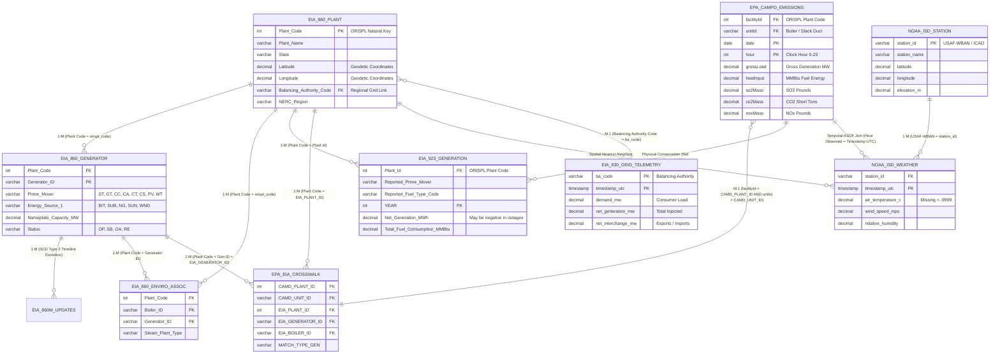

# Master Data Sources Specification & Inter-Source Relational Architecture
**Project:** Integrated Analysis of U.S. Bulk Power Generation, Smokestack Air Emissions, and Synoptic Weather  
**System Architecture:** Databricks Serverless Cloud Lakehouse (Delta Lake, PySpark, Unity Catalog)  
**Temporal Horizon:** 4-Year National Horizon (2021 – 2024: 35,064 hourly periods, 1,461 calendar days)  
**Catalog / Schemas:** `dwbi_catalog` (`bronze_staging`, `silver_conformed`, `gold_warehouse`, `gold_marts`, `quarantine`)  
**Companion Artifacts:** [`PROJECT_BLUEPRINT.md`](file:///d:/Semester%20Projects/DWBI%20LAB%20Project/PROJECT_BLUEPRINT.md), [`DATABRICKS_SERVERLESS_ARCHITECTURE.md`](file:///d:/Semester%20Projects/DWBI%20LAB%20Project/DATABRICKS_SERVERLESS_ARCHITECTURE.md), [`Data_Dictionary.xlsx`](file:///d:/Semester%20Projects/DWBI%20LAB%20Project/01_Project_Documentation/Data_Dictionary.xlsx)

---

## 1. Executive Overview & Data Source Ecosystem

### 1.1 Ecosystem Scope and Rationale
The primary objective of this Data Warehousing and Business Intelligence (DWBI) enterprise platform is to unify three decoupled domains of the United States energy infrastructure that have historically operated in isolated institutional silos:
1. **Bulk Electric Power Generation and Fuel Consumption** (tracked by the U.S. Energy Information Administration - EIA).
2. **Smokestack Flue-Gas Air Emissions and Thermal Loading** (monitored by the U.S. Environmental Protection Agency - EPA Clean Air Markets Division).
3. **Synoptic Surface Weather and Thermodynamic Ambient Conditions** (collected by the National Oceanic and Atmospheric Administration - NOAA National Centers for Environmental Information).

Understanding the complex interactions between extreme climate events (heat waves, winter freezes), power generation dispatch, thermal efficiency (heat rates), and air pollutant plumes ($\text{CO}_2, \text{SO}_2, \text{NO}_x$) requires ingesting, cleansing, conforming, and relating heterogeneous data sources spanning disparate spatial and temporal grains.

```
┌──────────────────────────────────────────────────────────────────────────────────────────────────┐
│                                  DATA SOURCE ECOSYSTEM TAXONOMY                                  │
├────────────────────┬───────────────────────────────────┬─────────────────────┬───────────────────┤
│ Data Source        │ Publishing Federal Agency         │ Native Format       │ Ingestion Cadence │
├────────────────────┼───────────────────────────────────┼─────────────────────┼───────────────────┤
│ EIA-860            │ Energy Information Administration │ Multi-Tab MS Excel  │ Annual            │
│ EIA-860M           │ Energy Information Administration │ MS Excel            │ Monthly           │
│ EIA-923            │ Energy Information Administration │ Multi-Tab MS Excel  │ Monthly / Annual  │
│ EIA-930            │ Energy Information Administration │ REST JSON API / CSV │ Hourly Near-Real  │
│ EPA CAMPD (CEMS)   │ Environmental Protection Agency   │ REST JSON API / CSV │ Hourly Streaming  │
│ EPA-EIA Crosswalk  │ EPA CAMD & EIA Joint Working Grp  │ CSV / Relational    │ Periodic Baseline │
│ NOAA ISD (NCEI)    │ National Oceanic & Atmospheric Ad.│ JSON / Fixed-Width  │ Hourly Synoptic   │
└────────────────────┴───────────────────────────────────┴─────────────────────┴───────────────────┘
```

---

## 2. Exhaustive Data Source Directory & Technical Definitions

### 2.1 Source 1: EIA-860 (Annual Electric Generator Report)
* **Publishing Agency:** U.S. Energy Information Administration (EIA), Office of Energy Production & Consumption.
* **Statutory Mandate:** Public Law 93-275 (Federal Energy Administration Act of 1974). Mandatory for all grid-connected U.S. generating facilities with a combined nameplate capacity of 1 megawatt (MW) or greater.
* **Operational Scope:** Form EIA-860 collects comprehensive annual utility-, plant-, and generator-level asset data, including operational status, nameplate capacity, prime mover technology, primary/secondary energy sources, environmental controls, and cooling system designs.
* **Native Ingestion Structure:** Multi-tab Microsoft Excel workbooks (`.xlsx`) distributed in annual archives (`eia860YYYY.zip`). The primary operational schedules utilized in the Lakehouse are:
  1. `2___Plant_Y2023.xlsx` (Schedule 2: Plant Master Directory)
  2. `3_1_Generator_Y2023.xlsx` (Schedule 3: Generator Asset Inventory)
  3. `6_1_EnviroAssoc_Y2023.xlsx` (Schedule 6: Boiler-to-Generator Environmental Associations)
* **Native Grain:** 
  * Schedule 2: Facility Grain (One row per physical power plant; natural key: `Plant Code` / ORISPL).
  * Schedule 3: Electrical Generator Grain (One row per generator; composite natural key: `(Plant Code, Generator ID)`).
  * Schedule 6: Thermodynamic Association Grain (One row per boiler-generator-cooling pairing; natural key: `(Plant Code, Boiler ID, Generator ID)`).
* **Lakehouse Ingestion Target:** Bronze tables `bronze_staging.raw_eia860_generator` and `bronze_staging.raw_eia860_enviro_assoc`, feeding dimensional entities `dim_plant` and `dim_generator`.

#### Complete Attribute Definitions: EIA-860 Schedule 2 (Plant Master)
1. `Utility ID` (`STRING` / `INT`): Federal regulatory identification number assigned by EIA to the electric utility or corporate owner.
2. `Utility Name` (`STRING`): Legal corporate entity name operating or holding ownership of the facility.
3. `Plant Code` (`STRING` / `INT`): The **ORISPL** (Office of Regulatory Information Systems Plant License) code. This is the **authoritative, system-wide natural business key** for electric generating facilities across all federal energy datasets.
4. `Plant Name` (`STRING`): Official operating name of the generating station (e.g., `Barry`, `Gaston`, `Cumberland`).
5. `Street Address` (`STRING`): Physical postal address of the facility entrance gate.
6. `City` (`STRING`): Municipality where the plant is situated.
7. `State` (`STRING`): Two-letter standard US postal abbreviation (e.g., `AL`, `OH`, `TX`).
8. `Zip` (`STRING`): Five-digit postal routing zip code.
9. `County` (`STRING`): Local county or civil parish jurisdiction.
10. `Latitude` (`DECIMAL(9,6)`): Precise geodetic latitude coordinate in decimal degrees (NAD83/WGS84 datum), indispensable for geospatial spatial indexing and weather station distance calculations.
11. `Longitude` (`DECIMAL(9,6)`): Precise geodetic longitude coordinate in decimal degrees (NAD83/WGS84 datum).
12. `NERC Region` (`STRING`): North American Electric Reliability Corporation regional reliability entity (e.g., `SERC`, `RFC`, `TRE`, `MRO`, `NPCC`, `WECC`).
13. `Balancing Authority Code` (`STRING`): Alphanumeric code of the Balancing Authority responsible for regional grid matching (e.g., `SOCO`, `PJM`, `ERCO`, `MISO`, `CISO`).
14. `Balancing Authority Name` (`STRING`): Full corporate description of the regional transmission grid operator.
15. `Name of Water Source` (`STRING`): River, lake, aquifer, or ocean used for once-through or closed-loop cooling towers.
16. `Primary Purpose (NAICS Code)` (`STRING` / `INT`): North American Industry Classification System code (e.g., `22` for Electric Utilities).
17. `Regulatory Status` (`STRING`): Regulatory oversight status (`RE` = Regulated cost-of-service utility, `NR` = Non-regulated merchant independent power producer).
18. `Sector` (`INT`): Numeric classification code (1–7) classifying industrial, commercial, and utility producers.
19. `Sector Name` (`STRING`): Human-readable sector categorization (e.g., `Electric Utility`, `IPP Non-CHP`, `Commercial CHP`).
20. `FERC Cogeneration Status` (`CHAR(1)`): Flag indicating if plant holds qualifying facility (QF) cogeneration status under PURPA (`Y`/`N`).
21. `FERC Cogeneration Docket Number` (`STRING`): Federal docket registration number for cogeneration assets.
22. `FERC Small Power Producer Status` (`CHAR(1)`): Flag indicating small qualifying renewable power facility under PURPA (`Y`/`N`).
23. `FERC Small Power Producer Docket Number` (`STRING`): Regulatory docket tracking number for small producers.
24. `FERC Exempt Wholesale Generator Status` (`CHAR(1)`): Status under Public Utility Holding Company Act (`Y`/`N`).
25. `FERC Exempt Wholesale Generator Docket Number` (`STRING`): Registration docket for wholesale generation exemption.
26. `Ash Impoundment?` (`CHAR(1)`): Indicates presence of coal combustion residual (CCR) ash ponds/impoundments (`Y`/`N`).
27. `Ash Impoundment Lined?` (`CHAR(1)`): Environmental safeguard indicator showing if coal ash ponds have composite liners (`Y`/`N`).
28. `Ash Impoundment Status` (`STRING`): Operating state of ash storage facilities (`OP` = Operating, `CL` = Closed).
29. `Transmission or Distribution System Owner` (`STRING`): Name of utility owning interconnected high-voltage transmission lines.
30. `Transmission or Distribution System Owner ID` (`INT`): EIA corporate code for transmission network operator.
31. `Transmission or Distribution System Owner State` (`STRING`): Jurisdiction of interconnecting transmission utility.
32. `Grid Voltage (kV)` (`DECIMAL(6,2)`): Primary point-of-interconnection busbar voltage in kilovolts.
33. `Grid Voltage 2 (kV)` (`DECIMAL(6,2)`): Secondary substation delivery voltage level.
34. `Grid Voltage 3 (kV)` (`DECIMAL(6,2)`): Tertiary substation delivery voltage level.
35. `Energy Storage` (`CHAR(1)`): Binary indicator showing presence of collocated battery, pumped hydro, or mechanical storage (`Y`/`N`).
36. `Natural Gas LDC Name` (`STRING`): Local gas distribution company providing pipeline firm supply.
37. `Natural Gas Pipeline Name 1` (`STRING`): Primary interstate or intrastate natural gas pipeline connected to plant receipt meter.
38. `Natural Gas Pipeline Name 2` (`STRING`): Secondary interconnected gas pipeline.
39. `Natural Gas Pipeline Name 3` (`STRING`): Tertiary interconnected gas pipeline.
40. `Pipeline Notes` (`STRING`): Narrative qualitative notes regarding gas delivery firmness or pipeline taps.
41. `Natural Gas Storage` (`CHAR(1)`): Indicates on-site gas storage cavern or vessel capacity (`Y`/`N`).
42. `Liquefied Natural Gas Storage` (`CHAR(1)`): Indicates on-site cryogenic LNG storage infrastructure (`Y`/`N`).

#### Complete Attribute Definitions: EIA-860 Schedule 3 (Generator Inventory)
1. `Utility ID` (`STRING` / `INT`): EIA utility identification code.
2. `Utility Name` (`STRING`): Operating utility company title.
3. `Plant Code` (`INT`): Master ORISPL facility code.
4. `Plant Name` (`STRING`): Name of the facility.
5. `State` (`STRING`): Two-character state identifier.
6. `County` (`STRING`): County jurisdiction.
7. `Generator ID` (`STRING`): Alphanumeric unit identifier assigned by plant engineers (e.g., `1`, `GEN2`, `CTG-1`, `ST-01`). Combined with `Plant Code`, forms the business natural key.
8. `Technology` (`STRING`): Engineering equipment classification (e.g., `Natural Gas Steam Turbine`, `Conventional Steam Coal`, `Natural Gas Fired Combined Cycle`, `Onshore Wind Turbine`, `Solar Photovoltaic`).
9. `Prime Mover` (`STRING`): Two-character thermodynamic prime mover code (e.g., `ST` = Steam Turbine, `GT` = Gas Combustion Turbine, `CC` = Combined Cycle Total Unit, `CA` = Combined Cycle Steam, `CT` = Combined Cycle Gas Turbine, `CS` = Combined Cycle Single-Shaft, `PV` = Solar Photovoltaic, `WT` = Wind Turbine, `HY` = Conventional Hydroelectric).
10. `Unit Code` (`STRING`): Composite grouping code used by utilities to group combined-cycle power train blocks.
11. `Ownership` (`STRING`): Ownership structure code (`S` = Single utility, `J` = Joint-venture ownership, `W` = Wholly owned non-utility).
12. `Duct Burners` (`CHAR(1)`): Indicates if Heat Recovery Steam Generator (HRSG) includes supplemental gas duct firing (`Y`/`N`).
13. `Can Bypass Heat Recovery Steam Generator?` (`CHAR(1)`): Mechanical bypass damper flag allowing gas turbine to run simple-cycle (`Y`/`N`).
14. `RTO/ISO LMP Node Designation` (`STRING`): Wholesale electricity market Locational Marginal Pricing (LMP) node name.
15. `RTO/ISO Location Designation for Reporting Wholesale Sales Data to FERC` (`STRING`): Market node code reported to FERC.
16. `Nameplate Capacity (MW)` (`DECIMAL(10,2)`): Maximum manufacturer design electrical rating at full power output under standard conditions.
17. `Nameplate Power Factor` (`DECIMAL(4,2)`): Ratio of true electric power output to apparent power (typically 0.80 to 0.90).
18. `Summer Capacity (MW)` (`DECIMAL(10,2)`): Maximum net deliverable electric output during high-ambient-temperature summer peak conditions.
19. `Winter Capacity (MW)` (`DECIMAL(10,2)`): Maximum net deliverable output during cold-ambient-temperature winter conditions.
20. `Minimum Load (MW)` (`DECIMAL(10,2)`): Lowest economic operational generation setpoint before unit must shut down.
21. `Uprate or Derate Completed During Year` (`CHAR(1)`): Indicator of major capacity modification within reporting year (`Y`/`N`).
22. `Month Uprate or Derate Completed` (`INT`): Month of engineering modification.
23. `Year Uprate or Derate Completed` (`INT`): Year of engineering modification.
24. `Status` (`STRING`): Official operating state:
    * `OP`: Operating in commercial active service.
    * `SB`: Cold standby or reserve capacity.
    * `OA`: Out of service / temporary repair, expected to return.
    * `RE`: Permanently retired / decommissioned.
25. `Synchronized to Transmission Grid` (`CHAR(1)`): Indicator showing generator synchronizes to AC grid frequency (`Y`/`N`).
26. `Operating Month` (`INT`): Month unit achieved initial commercial synchronization.
27. `Operating Year` (`INT`): Year of commercial commissioning.
28. `Planned Retirement Month` (`INT`): Scheduled retirement month.
29. `Planned Retirement Year` (`INT`): Scheduled retirement year.
30. `Associated with Combined Heat and Power System` (`CHAR(1)`): Cogeneration flag (`Y`/`N`).
31. `Sector Name` (`STRING`): Functional business sector label.
32. `Sector` (`INT`): Sector numeric code.
33. `Topping or Bottoming` (`CHAR(1)`): Thermodynamic arrangement in CHP plants (`T` = Topping cycle, `B` = Bottoming cycle).
34. `Energy Source 1` (`STRING`): Primary fuel source code (e.g., `BIT`, `SUB`, `NG`, `DFO`, `WND`, `SUN`, `NUC`).
35. `Energy Source 2` (`STRING`): Secondary or startup fuel code.
36. `Energy Source 3` (`STRING`): Tertiary fuel code.
37. `Energy Source 4` (`STRING`): Alternate fuel code.
38. `Energy Source 5` (`STRING`): Alternate fuel code.
39. `Energy Source 6` (`STRING`): Alternate fuel code.
40. `Startup Source 1` (`STRING`): Fuel used for flame ignition and boiler pre-warming (e.g., `NG`, `DFO`).
41. `Startup Source 2` (`STRING`): Secondary startup fuel.
42. `Startup Source 3` (`STRING`): Tertiary startup fuel.
43. `Startup Source 4` (`STRING`): Quaternary startup fuel.
44. `Solid Fuel Gasification System?` (`CHAR(1)`): Integrated gasification combined-cycle (IGCC) indicator (`Y`/`N`).
45. `Carbon Capture Technology?` (`CHAR(1)`): Indicates post-combustion or pre-combustion carbon capture system (`Y`/`N`).
46. `Turbines or Hydrokinetic Buoys` (`INT`): Count of wind turbines or marine hydrokinetic devices represented in row.
47. `Time from Cold Shutdown to Full Load` (`STRING`): Startup ramp duration category (e.g., `< 1 HOUR`, `OVER 12 HOURS`).
48. `Fluidized Bed Technology?` (`CHAR(1)`): Atmospheric or pressurized circulating fluidized bed coal boiler (`Y`/`N`).
49. `Pulverized Coal Technology?` (`CHAR(1)`): Conventional pulverized coal boiler design (`Y`/`N`).
50. `Stoker Technology?` (`CHAR(1)`): Mechanical spreader stoker solid fuel firing (`Y`/`N`).
51. `Other Combustion Technology?` (`CHAR(1)`): Cyclonic or specialized combustion chamber (`Y`/`N`).
52. `Subcritical Technology?` (`CHAR(1)`): Steam pressure below 3,200 psi (Carnot efficiency ~32–34%) (`Y`/`N`).
53. `Supercritical Technology?` (`CHAR(1)`): Steam pressure above thermodynamic critical point (efficiency ~37–40%) (`Y`/`N`).
54. `Ultrasupercritical Technology?` (`CHAR(1)`): Advanced steam metallurgy exceeding 1,100°F (efficiency >42%) (`Y`/`N`).
55. `Planned Net Summer Capacity Uprate (MW)` (`DECIMAL(10,2)`): Scheduled future summer capacity addition.
56. `Planned Net Winter Capacity Uprate (MW)` (`DECIMAL(10,2)`): Scheduled future winter capacity addition.
57. `Planned Uprate Month` (`INT`): Projected month of future uprate.
58. `Planned Uprate Year` (`INT`): Projected year of future uprate.
59. `Planned Net Summer Capacity Derate (MW)` (`DECIMAL(10,2)`): Scheduled future reduction in summer capacity.
60. `Planned Net Winter Capacity Derate (MW)` (`DECIMAL(10,2)`): Scheduled future reduction in winter capacity.
61. `Planned Derate Month` (`INT`): Projected month of derate.
62. `Planned Derate Year` (`INT`): Projected year of derate.
63. `Planned New Prime Mover` (`STRING`): Future prime mover code if repowering unit.
64. `Planned Energy Source 1` (`STRING`): Future fuel code if repowering unit.
65. `Planned New Nameplate Capacity (MW)` (`DECIMAL(10,2)`): Projected total capacity post-modification.
66. `Planned Repower Month` (`INT`): Repowering execution month.
67. `Planned Repower Year` (`INT`): Repowering execution year.
68. `Other Planned Modifications?` (`CHAR(1)`): Indicator for environmental retrofits or life-extension overhauls (`Y`/`N`).
69. `Other Modifications Month` (`INT`): Modification month.
70. `Other Modifications Year` (`INT`): Modification year.
71. `Multiple Fuels?` (`CHAR(1)`): Unit has burner assemblies capable of firing multiple energy sources (`Y`/`N`).
72. `Cofire Fuels?` (`CHAR(1)`): Unit can simultaneously burn biomass with coal or gas with fuel oil (`Y`/`N`).
73. `Switch Between Oil and Natural Gas?` (`CHAR(1)`): Quick-switch capability for fuel curtailment emergencies (`Y`/`N`).

#### Complete Attribute Definitions: EIA-860 Schedule 6_1 (Environmental Associations)
1. `Utility ID` (`STRING` / `INT`): Corporate utility identifier.
2. `Utility Name` (`STRING`): Utility corporate description.
3. `Plant Code` (`INT`): Master ORISPL code.
4. `Plant Name` (`STRING`): Facility name.
5. `Boiler ID` (`STRING`): Physical combustion steam generator / boiler alphanumeric tag (e.g., `1`, `B1`, `BLR-04`).
6. `Generator ID` (`STRING`): Electrical power generation turbine rotor tag (e.g., `1`, `GEN1`).
7. `Steam Plant Type` (`STRING` / `FLOAT`): Engineering classification of boiler-to-turbine steam loop configuration.

---

### 2.2 Source 2: EIA-860M (Monthly Electric Generator Report)
* **Publishing Agency:** U.S. Energy Information Administration (EIA).
* **Operational Scope:** A high-frequency monthly update supplement to the annual EIA-860. It captures rapid, real-time changes in the national generation fleet, specifically tracking **new commercial grid connections, temporary mothballing, unexpected generator retirements, and fuel-switching modifications**.
* **Role in Warehouse / Lakehouse:** Powers the **Slowly Changing Dimension Type 2 (SCD Type 2)** tracking engine on [`dim_generator`](file:///d:/Semester%20Projects/DWBI%20LAB%20Project/04_Data_Warehouse/warehouse.sql#L61-L75). When an operating coal unit transitions from `Status = 'OP'` to `Status = 'RE'`, EIA-860M delivers the event timestamp, allowing the pipeline to expire the active row (`valid_to = event_date`, `is_current = FALSE`) and insert the new historical row.
* **Key Attributes Tracked:**
  1. `Plant Code` (`INT`): ORISPL code.
  2. `Generator ID` (`STRING`): Generating unit tag.
  3. `Operating Status Code` (`STRING`): Real-time status update (`OP`, `SB`, `OA`, `RE`).
  4. `Effective Date / Operating Month-Year` (`DATE` / `INT`): Exact calendar period of transition.
  5. `Net Summer Capacity (MW)` (`DECIMAL(10,2)`): Updated capacity rating.
  6. `Energy Source 1` (`STRING`): Current active fuel code.

---

### 2.3 Source 3: EIA-923 (Power Plant Operations Report)
* **Publishing Agency:** U.S. Energy Information Administration (EIA).
* **Statutory Authority:** Mandatory filing under Section 13(b) of Federal Energy Administration Act of 1974 for electric plants $\ge 1\text{ MW}$.
* **Operational Scope:** The federal government's primary source for monthly power plant electrical generation, thermal fuel efficiency, energy consumption by fuel type, delivered fuel procurement prices, and fuel stock inventory balances.
* **Native Ingestion Structure:** Multi-tab Microsoft Excel workbook (`EIA923_Schedules_2_3_4_5_M_12_2023_Final_Revision.xlsx`). Primary sheet: `Page 1 Generation and Fuel Data`.
* **Native Grain:** Plant, Prime Mover, and Fuel Type Grain aggregated per Month (One record per `Plant Id` + `Reported Prime Mover` + `Reported Fuel Type Code` per calendar year, formatted with 12 monthly columns for each physical measurement).
* **Lakehouse Ingestion Target:** Bronze table `bronze_staging.raw_eia923_monthly_generation`, feeding periodic snapshot fact `fact_monthly_plant_operations`.

#### Complete Attribute Definitions: EIA-923 (Page 1 Generation & Fuel Data)
1. `Plant Id` (`INT`): Master ORISPL plant code matching EIA-860 and EPA CAMPD.
2. `Combined Heat And Power Plant` (`CHAR(1)`): Indicator of cogeneration status (`Y`/`N`).
3. `Nuclear Unit Id` (`STRING`): Specific NRC reactor unit identifier for nuclear stations (holds string sentinels `.` for non-nuclear assets).
4. `Plant Name` (`STRING`): Facility operating name.
5. `Operator Name` (`STRING`): Corporate operating company title.
6. `Operator Id` (`INT`): Corporate utility code.
7. `Plant State` (`STRING`): Two-letter state postal code.
8. `Census Region` (`STRING`): US Census Division (e.g., `ESC` = East South Central, `ENC` = East North Central, `MAT` = Mid-Atlantic).
9. `NERC Region` (`STRING`): Regional electric reliability council identifier.
10. `Reserved` (`STRING`): Federal administrative column.
11. `NAICS Code` (`INT`): North American Industry Classification System numeric code.
12. `EIA Sector Number` (`INT`): Sector code (1 through 7).
13. `Sector Name` (`STRING`): Sector title (e.g., `Electric Utility`).
14. `Reported Prime Mover` (`STRING`): Thermodynamic prime mover code under which fuel was consumed (e.g., `ST`, `GT`, `CA`, `CT`, `CS`).
15. `Reported Fuel Type Code` (`STRING`): Standard fuel code (e.g., `BIT`, `SUB`, `LIG`, `NG`, `DFO`, `RFO`, `WND`, `SUN`).
16. `MER Fuel Type Code` (`STRING`): Monthly Energy Review aggregated fuel categorization.
17. `Balancing Authority Code` (`STRING`): Balancing Authority grid code (e.g., `SOCO`, `PJM`, `ERCO`).
18. `Respondent Frequency` (`CHAR(1)`): Reporting frequency required by EIA (`M` = Monthly, `A` = Annual sample).
19. `Physical Unit Label` (`STRING`): Unit of measurement for raw fuel volume:
    * `tons`: Short tons of coal or solid biomass.
    * `barrels`: 42-gallon barrels of fuel oil/diesel.
    * `mcf`: Thousand cubic feet of natural gas.
20–31. `Quantity January` through `Quantity December` (12 columns, `DECIMAL(14,3)`): Total physical quantity of fuel consumed in each respective calendar month for both electric power generation and useful thermal output (contains text sentinels `.` and `NM` in raw files).
32–43. `Elec_Quantity January` through `Elec_Quantity December` (12 columns, `DECIMAL(14,3)`): Portion of physical fuel consumed solely for the generation of electricity.
44–55. `MMBtuPer_Unit January` through `MMBtuPer_Unit December` (12 columns, `DECIMAL(8,4)`): Gross heat content / higher heating value (HHV) per physical unit of fuel (e.g., MMBtu per ton of coal, MMBtu per mcf of gas).
56–67. `Tot_MMBtu January` through `Tot_MMBtu December` (12 columns, `DECIMAL(14,3)`): Total heat content of all fuel consumed (Physical Quantity $\times$ MMBtu per Unit).
68–79. `Elec_MMBtu January` through `Elec_MMBtu December` (12 columns, `DECIMAL(14,3)`): Total heat content of fuel consumed dedicated solely to electrical power generation.
80–91. `Netgen January` through `Netgen December` (12 columns, `DECIMAL(14,3)`): Net electrical generation dispatched to the transmission grid in **Megawatthours (MWh)**. Critical physical rule: **Allows negative numbers** when offline plants draw auxiliary station power.
92. `Total Fuel Consumption Quantity` (`DECIMAL(14,3)`): Annual sum of total physical fuel consumed across all 12 months.
93. `Electric Fuel Consumption Quantity` (`DECIMAL(14,3)`): Annual sum of fuel consumed dedicated to electricity generation.
94. `Total Fuel Consumption MMBtu` (`DECIMAL(14,3)`): Annual sum of total thermal energy input.
95. `Elec Fuel Consumption MMBtu` (`DECIMAL(14,3)`): Annual sum of electrical thermal energy input.
96. `Net Generation (Megawatthours)` (`DECIMAL(14,3)`): Annual cumulative net generation dispatched.
97. `YEAR` (`INT`): Calendar reporting year (e.g., `2023`).

---

### 2.4 Source 4: EIA-930 (Hourly Electric Grid Monitor)
* **Publishing Agency:** U.S. Energy Information Administration (EIA).
* **Operational Scope:** A near-real-time hourly grid telemetry feed compiling operating data from all 66 Balancing Authorities across the contiguous United States (Lower 48).
* **Operational Significance:** Captures the dynamic macro-balance between consumer electrical demand, day-ahead load forecasts, real-time dispatch by primary generation fuel type, and wholesale electrical power interchange flows across regional boundaries.
* **Native Ingestion Structure:** RESTful JSON Web API endpoints (`api.eia.gov/v2/electricity/rto/`) and bulk hourly CSV exports.
* **Native Grain:** Hourly per Balancing Authority (Composite key: `ba_code` + `timestamp_utc`).
* **Lakehouse Ingestion Target:** Bronze table `bronze_staging.raw_eia930_hourly_balance`, feeding Kimball aggregate grid fact `fact_regional_grid_demand` and dimension `dim_balancing_authority`.

#### Complete Attribute Definitions: EIA-930 (Hourly Grid Telemetry)
1. `ba_code` (`STRING`): Standard business code identifying the Balancing Authority (e.g., `SOCO`, `PJM`, `ERCO`, `MISO`, `NYIS`, `CISO`, `ISNE`).
2. `ba_name` (`STRING`): Full corporate title of the grid operator (e.g., `Southern Company Services, Inc.`, `PJM Interconnection`).
3. `interconnect` (`STRING`): Major North American electrical synchronous interconnection grid (`Eastern`, `Western`, `Texas`).
4. `timestamp_utc` (`TIMESTAMP`): High-precision Universal Coordinated Time observation timestamp.
5. `local_time` (`STRING`): Local civil clock timestamp including prevailing Daylight Saving Time offsets.
6. `demand_mw` (`DECIMAL(12,2)`): Total instantaneous electrical power demand (load) demanded by consumers on the BA's network in Megawatts (MW).
7. `demand_forecast_mw` (`DECIMAL(12,2)`): Day-ahead scheduled hourly demand forecast produced by grid dispatch modeling algorithms.
8. `net_generation_mw` (`DECIMAL(12,2)`): Total net electrical power injected into the transmission grid by all generating units within the BA territory.
9. `net_interchange_mw` (`DECIMAL(12,2)`): Net scheduled and actual electrical power flowing across tie-lines into or out of neighboring Balancing Authorities (positive = exporting power; negative = importing power).
10. `gen_coal_mw` (`DECIMAL(12,2)`): Real-time generation dispatched from coal-fired steam generators in Megawatts.
11. `gen_natgas_mw` (`DECIMAL(12,2)`): Real-time generation dispatched from natural gas units (combined cycle and peakers).
12. `gen_nuclear_mw` (`DECIMAL(12,2)`): Real-time baseline generation from nuclear fission reactors.
13. `gen_hydro_mw` (`DECIMAL(12,2)`): Real-time generation from conventional hydroelectric facilities.
14. `gen_solar_mw` (`DECIMAL(12,2)`): Real-time generation from grid-scale photovoltaic solar farms.
15. `gen_wind_mw` (`DECIMAL(12,2)`): Real-time generation from utility-scale onshore and offshore wind farms.

---

### 2.5 Source 5: EPA CAMPD (Continuous Emission Monitoring System - CEMS)
* **Publishing Agency:** U.S. Environmental Protection Agency (EPA), Clean Air Markets Division (CAMD).
* **Statutory Mandate:** Clean Air Act Title IV (Acid Rain Program - ARP), Cross-State Air Pollution Rule (CSAPR), and Clean Air Interstate Rule (CAIR). Mandatory 40 CFR Part 75 CEMS monitoring.
* **Operational Scope:** Continuous, automated in-stack instrumental telemetry recording gross electrical load, fuel heat input, and mass emissions of criteria air pollutants and greenhouse gases from large utility and industrial combustion units.
* **Native Ingestion Structure:** EPA Clean Air Markets API / CAMPD Streaming REST Services (`https://api.epa.gov/easey/streaming-services/emissions/apportioned/hourly`) and bulk monthly CSV dumps.
* **Native Grain:** Hourly per Combustion Smokestack / Boiler Unit (Composite natural key: `facilityId` + `unitId` + `date` + `hour`).
* **Lakehouse Ingestion Target:** Bronze table `bronze_staging.raw_epa_hourly_emissions`, feeding transactional fact table `fact_hourly_emissions_weather`.

#### Complete Attribute Definitions: EPA CAMPD Hourly Emissions
1. `stateCode` (`STRING`): Two-letter postal abbreviation for the facility location.
2. `facilityName` (`STRING`): Name of the power plant facility (matches EIA plant name).
3. `facilityId` (`INT`): Authoritative federal ORISPL plant code matching EIA `Plant Code`.
4. `unitId` (`STRING`): Operating unit alphanumeric identifier (combustion boiler, gas turbine rotor, or common combined smokestack duct).
5. `unit_id` (`STRING`): Standardized alternative representation of unit identifier.
6. `associatedStacks` (`STRING`): Smokestack ducting identifier when flue gas from multiple boilers is merged into a common stack (e.g., `CS0AAN`).
7. `date` (`DATE` / `STRING`): Observation calendar date (`YYYY-MM-DD`).
8. `hour` (`INT`): Clock hour interval of measurement in local standard time (integer 0 through 23).
9. `opTime` (`DECIMAL(4,2)`): Operational time fraction during which fuel was actively combusted within the clock hour (range `0.00` to `1.00`).
10. `grossLoad` (`DECIMAL(10,2)`): Total gross electrical power output measured directly at generator terminals in **Megawatts (MW)**. (Always $\ge$ EIA Net Generation).
11. `steamLoad` (`DECIMAL(10,2)`): Useful thermal steam production output for industrial host facilities in thousands of pounds per hour (1000 lbs/hr).
12. `so2Mass` (`DECIMAL(12,3)`): Total mass emission of **Sulfur Dioxide ($\text{SO}_2$)** released during the hour, measured in **pounds (lbs)**.
13. `so2MassMeasureFlg` (`STRING`): Sensor measurement assurance flag:
    * `Measured`: Direct reading from certified dilution or extractive optical spectrometer.
    * `Substitute`: Calculated via EPA Part 75 missing data substitution algorithms during sensor failure.
14. `so2Rate` (`DECIMAL(8,4)`): Calculated $\text{SO}_2$ emission intensity in pounds per MMBtu ($\text{lbs}/\text{MMBtu}$).
15. `so2RateMeasureFlg` (`STRING`): Quality flag for $\text{SO}_2$ rate calculation.
16. `co2Mass` (`DECIMAL(12,3)`): Total mass emission of **Carbon Dioxide ($\text{CO}_2$)** released, recorded in **short tons (2,000 lbs)**.
17. `co2MassMeasureFlg` (`STRING`): Sensor measurement method flag for $\text{CO}_2$.
18. `co2Rate` (`DECIMAL(8,4)`): Rate of $\text{CO}_2$ emissions in short tons per MMBtu.
19. `co2RateMeasureFlg` (`STRING`): Quality flag for $\text{CO}_2$ emission rate.
20. `noxMass` (`DECIMAL(12,3)`): Total mass emission of **Nitrogen Oxides ($\text{NO}_x$)** in **pounds (lbs)**.
21. `noxMassMeasureFlg` (`STRING`): Sensor assurance method flag for $\text{NO}_x$.
22. `noxRate` (`DECIMAL(8,4)`): Certified $\text{NO}_x$ emission rate in pounds per MMBtu ($\text{lbs}/\text{MMBtu}$).
23. `noxRateMeasureFlg` (`STRING`): Quality flag for $\text{NO}_x$ rate.
24. `heatInput` (`DECIMAL(12,3)`): Total thermal heat input of combusted fuel in **Million British Thermal Units (MMBtu)**.
25. `heatInputMeasureFlg` (`STRING`): Measurement assurance flag for fuel thermal energy.
26. `primaryFuelInfo` (`STRING`): Dominant fuel combusted in the unit during the reporting period (e.g., `Pipeline Natural Gas`, `Coal`, `Residual Oil`).
27. `secondaryFuelInfo` (`STRING`): Backup or startup fuel.
28. `unitType` (`STRING`): Mechanical boiler combustion architecture (e.g., `Tangentially-fired`, `Dry bottom wall-fired boiler`, `Combined cycle`, `Combustion turbine`).
29. `so2ControlInfo` (`STRING`): Installed post-combustion sulfur abatement systems (e.g., `Wet Limestone Scrubber`, `Dry Sorbent Injection`).
30. `noxControlInfo` (`STRING`): Installed nitrogen oxide abatement technology (e.g., `Low NOx Burner`, `Selective Catalytic Reduction - SCR`, `SNCR`).
31. `pmControlInfo` (`STRING`): Particulate matter controls (e.g., `Electrostatic Precipitator - ESP`, `Fabric Filter Baghouse`).
32. `hgControlInfo` (`STRING`): Mercury and hazardous air pollutant control systems (e.g., `Activated Carbon Injection`).
33. `programCodeInfo` (`STRING`): Specific statutory federal regulatory programs governing unit (e.g., `ARP, CSNOX, CSOSG2, CSSO2G2`).

---

### 2.6 Source 6: EPA–EIA Crosswalk (Bipartite Power Sector Crosswalk)
* **Publishing Agency:** Joint initiative of U.S. EPA Clean Air Markets Division and U.S. Energy Information Administration.
* **Operational Scope:** Solves the primary structural integration challenge in energy informatics: **EPA monitors emissions at the Smokestack / Boiler Unit level (`CAMD_UNIT_ID`), whereas EIA monitors assets at the Generator Turbine level (`EIA_GENERATOR_ID`)**.
* **Mathematical Role:** Acts as a **bipartite adjacency bridging table** resolving M:N and 1:M thermodynamic relationships between physical combustion units and electricity-generating equipment.
* **Native Ingestion Structure:** Public CSV file distributed via GitHub (`USEPA/camd-eia-crosswalk/master/epa_eia_crosswalk.csv`).
* **Native Grain:** One row per specific boiler-generator physical pairing.
* **Lakehouse Ingestion Target:** Silver enrichment graph and relational join resolving EPA CAMPD emissions down to EIA plant assets.

#### Complete Attribute Definitions: EPA–EIA Crosswalk
1. `SEQUENCE_NUMBER` (`INT`): Synthetic primary row identifier.
2. `CAMD_STATE` (`STRING`): EPA state postal code.
3. `CAMD_FACILITY_NAME` (`STRING`): EPA official plant facility name.
4. `CAMD_PLANT_ID` (`INT`): EPA ORISPL plant code.
5. `CAMD_UNIT_ID` (`STRING`): EPA continuous emissions monitor combustion unit tag.
6. `CAMD_GENERATOR_ID` (`STRING`): Generator tag as reported to EPA.
7. `CAMD_NAMEPLATE_CAPACITY` (`DECIMAL(10,2)`): Generator electrical capacity reported to EPA.
8. `CAMD_FUEL_TYPE` (`STRING`): Primary fuel registered with EPA CAMD.
9. `CAMD_LATITUDE` (`DECIMAL(9,6)`): Latitude coordinates in EPA registry.
10. `CAMD_LONGITUDE` (`DECIMAL(9,6)`): Longitude coordinates in EPA registry.
11. `CAMD_STATUS` (`STRING`): EPA operational status code (`OPR` = Operating, `RET` = Retired).
12. `CAMD_STATUS_DATE` (`TIMESTAMP` / `STRING`): Date of status determination.
13. `CAMD_RETIRE_YEAR` (`INT`): Year of retirement according to EPA records.
14. `MOD_CAMD_UNIT_ID` (`STRING`): Standardized/normalized CAMD unit ID.
15. `MOD_CAMD_GENERATOR_ID` (`STRING`): Standardized/normalized CAMD generator ID.
16. `EIA_STATE` (`STRING`): EIA state code.
17. `EIA_PLANT_NAME` (`STRING`): EIA plant name.
18. `EIA_PLANT_ID` (`INT`): EIA master ORISPL code (Must match `CAMD_PLANT_ID`).
19. `EIA_GENERATOR_ID` (`STRING`): EIA generator rotor identifier from Form EIA-860 Schedule 3.
20. `EIA_NAMEPLATE_CAPACITY` (`DECIMAL(10,2)`): EIA nameplate capacity rating (MW).
21. `EIA_BOILER_ID` (`STRING`): EIA boiler identifier from Form EIA-860 Schedule 6.
22. `EIA_UNIT_TYPE` (`STRING`): Prime mover classification according to EIA.
23. `EIA_FUEL_TYPE` (`STRING`): Fuel code recorded in EIA registries.
24. `EIA_LATITUDE` (`DECIMAL(9,6)`): Latitude coordinates recorded by EIA surveyors.
25. `EIA_LONGITUDE` (`DECIMAL(9,6)`): Longitude coordinates recorded by EIA surveyors.
26. `EIA_RETIRE_YEAR` (`INT`): Retirement year recorded in EIA Form 860.
27. `PLANT_ID_CHANGE_FLAG` (`INT`): Audit flag indicating whether federal facility code was historically altered (`0`/`1`).
28. `MOD_EIA_PLANT_ID` (`INT`): Standardized EIA plant code.
29. `MOD_EIA_BOILER_ID` (`STRING`): Standardized EIA boiler tag.
30. `MOD_EIA_GENERATOR_ID_BOILER` (`STRING`): Standardized generator ID derived from boiler association schedules.
31. `MOD_EIA_GENERATOR_ID_GEN` (`STRING`): Standardized generator ID derived from generator schedules.
32. `MATCH_TYPE_GEN` (`STRING`): Confidence methodology for generator matching (e.g., `3_1_Generator match on plant and gen IDs Step 1a: Exact match`).
33. `MATCH_TYPE_BOILER` (`STRING`): Confidence methodology for boiler matching (e.g., `6_1_EnviroAssoc match on plant, boiler, and gen IDs Step 2a: Exact match`).

---

### 2.7 Source 7: NOAA ISD (Integrated Surface Database & NCEI Weather)
* **Publishing Agency:** National Oceanic and Atmospheric Administration (NOAA), National Centers for Environmental Information (NCEI).
* **Operational Scope:** Global hourly and synoptic surface weather observations recorded by weather stations located at civil airports, military airbases, and automated surface observing system (ASOS) weather installations.
* **Thermodynamic Significance:** Ambient air temperature, atmospheric pressure, and humidity directly dictate the thermodynamic efficiency and peak output of thermal power plants (gas turbines and cooling towers):
  * Gas turbine output degrades by $5\%\text{ to }10\%$ during high ambient summer heat due to reduced air density.
  * Cooling tower heat dissipation capacity is constrained by atmospheric dewpoint and wet-bulb temperature.
* **Native Ingestion Structure:** Fixed-width ASCII formats (`isd.txt`), CSV history directories (`isd-history.csv`), and National Weather Service JSON API endpoints (`api.weather.gov/stations/{id}/observations`).
* **Native Grain:** Hourly per Surface Observation Station (Composite key: `station_id` + `timestamp_utc`).
* **Lakehouse Ingestion Target:** Bronze table `bronze_staging.raw_noaa_isd_weather`, dimension `dim_weather_station`, and fact `fact_hourly_emissions_weather`.

#### Complete Attribute Definitions: NOAA ISD Station History Master (`isd-history.csv`)
1. `USAF` (`STRING` / `INT`): Air Force Datsav3 station identifier (e.g., `722230`).
2. `WBAN` (`STRING` / `INT`): Weather Bureau Army Navy five-digit station identifier (e.g., `13894`). The concatenation `USAF-WBAN` forms the global unique natural key.
3. `STATION NAME` (`STRING`): Official operating name of airport or meteorological observatory (e.g., `MOBILE REGIONAL AIRPORT`).
4. `CTRY` (`STRING`): Two-letter FIPS country code (`US`).
5. `STATE` (`STRING`): Two-letter US postal state abbreviation.
6. `ICAO` (`STRING`): International Civil Aviation Organization four-letter airport designator (e.g., `KMOB`).
7. `LAT` (`DECIMAL(9,6)`): Station geodetic latitude in decimal degrees.
8. `LON` (`DECIMAL(9,6)`): Station geodetic longitude in decimal degrees.
9. `ELEV(M)` (`DECIMAL(7,2)`): Station elevation above mean sea level in meters.
10. `BEGIN` (`INT`): Earliest active observation date recorded (`YYYYMMDD`).
11. `END` (`INT`): Most recent operational observation date recorded (`YYYYMMDD`).

#### Complete Attribute Definitions: NOAA ISD Weather Observations (JSON / Surface Observation Feeds)
1. `@id` (`STRING`): Uniform Resource Identifier (URI) for the specific hourly observation event.
2. `@type` (`STRING`): GeoJSON object type descriptor (`wx:ObservationStation`).
3. `elevation` (`MAP` / `DECIMAL`): Elevation object containing measurement value and WMO unit (`meters`).
4. `station` (`STRING`): Web URL link to observing station asset.
5. `stationId` (`STRING`): Natural business station key (e.g., `KMOB` / USAF-WBAN).
6. `stationName` (`STRING`): Name of observing airfield or station.
7. `timestamp` (`TIMESTAMP`): High-precision UTC timestamp of meteorological observation.
8. `rawMessage` (`STRING`): Unparsed standard aeronautical METAR text message string.
9. `textDescription` (`STRING`): Concise sky cover narrative summary (e.g., `Clear`, `Partly Cloudy`, `Thunderstorm`, `Fog`).
10. `icon` (`STRING`): Web URL link to visual weather condition glyph.
11. `presentWeather` (`ARRAY`): Encoded automated weather sensor event array (rain, snow, drizzle).
12. `temperature` (`DECIMAL(5,2)`): Surface ambient dry-bulb temperature converted to **Degrees Celsius (°C)**. (Raw files contain sensor dropout sentinel `-9999`).
13. `dewpoint` (`DECIMAL(5,2)`): Surface dew point temperature in **Degrees Celsius (°C)**.
14. `windDirection` (`DECIMAL(5,1)`): Horizontal wind direction in compass degrees clockwise from true north (`0°` to `360°`).
15. `windSpeed` (`DECIMAL(5,2)`): Sustained surface wind velocity converted to **Meters per Second ($\text{m}/\text{s}$)**. (Crucial for wind turbine generation analysis and plume dispersion).
16. `windGust` (`DECIMAL(5,2)`): Peak instantaneous wind gust speed in meters per second.
17. `barometricPressure` (`DECIMAL(8,2)`): Actual station atmospheric pressure in **Pascals (Pa)**.
18. `seaLevelPressure` (`DECIMAL(8,2)`): Barometric pressure corrected to mean sea level in **Hectopascals / Millibars (hPa)**.
19. `visibility` (`DECIMAL(8,2)`): Prevailing horizontal visibility distance in **meters**.
20. `maxTemperatureLast24Hours` (`DECIMAL(5,2)`): Diurnal maximum temperature in °C.
21. `minTemperatureLast24Hours` (`DECIMAL(5,2)`): Diurnal minimum temperature in °C.
22. `precipitationLast3Hours` (`DECIMAL(6,2)`): Liquid precipitation accumulation in millimeters.
23. `relativeHumidity` (`DECIMAL(5,2)`): Ratio of water vapor partial pressure to equilibrium vapor pressure expressed as a percentage (`0.0%` to `100.0%`).
24. `windChill` (`DECIMAL(5,2)`): Apparent temperature calculated accounting for convective wind cooling in °C.
25. `heatIndex` (`DECIMAL(5,2)`): Apparent temperature accounting for evaporative moisture and high heat in °C.
26. `cloudLayers` (`ARRAY`): Sky condition cloud layer array documenting cloud base altitude (meters) and coverage amount (`CLR`, `FEW`, `SCT`, `BKN`, `OVC`).

---

## 3. Comprehensive Inter-Data Source Relational Graph & Linkages

### 3.1 Relational Architecture Diagram (Entity Relationships & Cross-Source Joins)



---

### 3.2 Detailed Relational Mappings & Integration Logic

#### 1. EIA-860 Plant Master $\longleftrightarrow$ EIA-923 Monthly Operations
* **Join Keys:** `EIA-860.Plant Code` $\equiv$ `EIA-923.Plant Id` (Federal ORISPL Code).
* **Cardinality:** **1-to-Many ($1:\text{M}$)**. A single power plant facility reports multiple monthly generation rows representing separate prime mover and fuel type combinations (e.g., Plant 3 Barry reports separate monthly lines for steam turbine natural gas, combined cycle natural gas, and steam coal).
* **Population Discrepancy & Non-Thermal Orphan Rule:**
  * While `EIA-923` covers the entire generation fleet (over 12,300 plants including hydro, wind, and solar), environmental boiler schedules in `EIA-860` only cover thermal combustion plants (~1,568 facilities).
  * **Critical Lakehouse Rule:** Never perform an unconditional `INNER JOIN` between generation records and boiler schedules. Clean renewable facilities (hydro, solar, wind) must resolve to standard default surrogate keys (`-1 = Not Applicable`).

#### 2. EIA-860 Plant & Generator $\longleftrightarrow$ EIA-860 EnviroAssoc Schedule 6_1
* **Join Keys:** Composite key `(Plant Code, Generator ID)` and `(Plant Code, Boiler ID)`.
* **Cardinality:** **Many-to-Many ($\text{M}:\text{N}$)**.
* **Engineering Architecture:** Power plants frequently operate complex thermodynamic configurations:
  * *Single-shaft combined cycle:* 1 Gas Turbine $\rightarrow$ 1 HRSG Boiler $\rightarrow$ 1 Steam Turbine ($1:1:1$).
  * *Multi-combustion train:* 2 Gas Turbines $\rightarrow$ 2 HRSG Boilers $\rightarrow$ 1 Common Steam Turbine ($2:2:1$).
  * *Header-type coal plants:* Multiple coal boilers discharging steam into a common steam header feeding multiple independent turbine generators.
  * In the Silver layer, this association is modeled as an **undirected bipartite adjacency graph** to allocate emissions without Cartesian row explosion.

#### 3. EIA-860 / EIA-923 $\longleftrightarrow$ EPA CAMPD via the EPA–EIA Crosswalk
* **Join Logic:**
  $$\text{EPA CAMPD (facilityId, unitId)} \xrightarrow{\text{CAMD\_PLANT\_ID, CAMD\_UNIT\_ID}} \text{EPA-EIA Crosswalk} \xrightarrow{\text{EIA\_PLANT\_ID, EIA\_BOILER\_ID, EIA\_GENERATOR\_ID}} \text{EIA-860 / EIA-923}$$
* **Cardinality:** **Many-to-Many Bipartite Mapping**.
* **Integration Rule:** EPA Continuous Emission Monitors record physical smokestack gas concentrations (`unitId` = flue duct or boiler). EIA records fuel inputs and net electrical generation at the electrical alternator rotor (`Generator ID`). The crosswalk bridges these disparate physical boundaries.

#### 4. EIA-923 Monthly Generation $\longleftrightarrow$ EPA CAMPD Hourly Emissions (Physical Conservation)
* **Reconciliation Formula:**
  $$\sum_{h \in \text{Month}} \text{EPA Gross Generation (MW)}_h \times 1\text{ hr} \ge \text{EIA Monthly Net Generation (MWh)}$$
* **Auxiliary Load Ratio Calculation:**
  $$\text{Auxiliary Load Ratio} = 1 - \frac{\text{EIA Net Generation (MWh)}}{\sum \text{EPA Gross Generation (MWh)}}$$
* **Physical Sanity Bounds:**
  * Gas Combined Cycle (CCGT): $2\%\text{ to }6\%$ parasitic station consumption.
  * Pulverized Coal Steam (ST): $6\%\text{ to }14\%$ parasitic consumption (running induced-draft fans, coal pulverizer mills, and wet limestone flue-gas desulfurization scrubbers).
  * Outage periods: Net generation becomes negative as offline plants draw power from the grid to maintain safety cooling and freeze protection.

#### 5. EIA-860 / EPA CAMPD $\longleftrightarrow$ EIA-930 Hourly Grid Telemetry
* **Join Keys:** `dim_plant.ba_code` $\equiv$ `fact_regional_grid_demand.ba_code` aligned on `(date_key, hour_of_day)`.
* **Cardinality:** **Many-to-One ($\text{M}:1$) Regional Aggregation**.
* **Analytical Purpose:** Enables drill-across analysis linking micro-level facility dispatch with macro-level grid reliability. When regional grid demand peaks on PJM or SOCO, the warehouse exposes which specific thermal plants ramped up generation and their corresponding marginal emissions plume.

#### 6. EIA-860 Plant Coordinates $\longleftrightarrow$ NOAA ISD Synoptic Surface Weather
* **Spatial Join Methodology:** Power generating plants rarely have on-site certified meteorological observatories. Spatial linkage uses the **Haversine Great-Circle Distance Algorithm**:
  $$d = 2R \arcsin\left(\sqrt{\sin^2\left(\frac{\Delta \phi}{2}\right) + \cos(\phi_{\text{plant}})\cos(\phi_{\text{station}})\sin^2\left(\frac{\Delta \lambda}{2}\right)}\right)$$
  Where $R = 6,371\text{ km}$, $\phi$ is geodetic latitude in radians, and $\lambda$ is longitude in radians.
* **Spatial Constraint:** Station search radius is bounded to $d \le 50\text{ km}$.
* **Temporal Alignment:** **ASOF Temporal Join** matching observation timestamps within a maximum tolerance window of $\pm 60\text{ minutes}$.
* **Lineage Tracking:** Foreign keys and audit lineage preserve `station_key`, `station_distance_km`, and `time_difference_minutes`.

#### 7. EIA-860 Generator Inventory $\longleftrightarrow$ EIA-860M (SCD Type 2 Tracking)
* **Join Keys:** Natural business key `(orispl_code, generator_id)`.
* **Cardinality:** **1-to-Many ($1:\text{M}$) Historical Versions**.
* **SCD Type 2 Lifecycle Engine:** Tracks changes in generator operating status (`operating_status` transitioning from `OP` $\rightarrow$ `SB` $\rightarrow$ `RE`):
  * Active Record: `valid_from = commissioning_date`, `valid_to = '9999-12-31 23:59:59'`, `is_current = TRUE`.
  * Decommissioning Event: On receipt of retirement notification, active record is expired (`valid_to = retirement_timestamp`, `is_current = FALSE`), and a new terminal record is inserted (`valid_from = retirement_timestamp`, `operating_status = 'RE'`, `is_current = TRUE`).

---

## 4. Master Data Sources Cross-Reference Matrix

The following reference matrix summarizes all primary join relationships, source data formats, natural keys, and target Lakehouse warehouse entities:

| Data Source | Natural Business Key | Related Data Source | Foreign / Join Key | Join Type / Mechanism | Target Lakehouse Layer & Entity |
| :--- | :--- | :--- | :--- | :--- | :--- |
| **EIA-860 (Plant)** | `Plant Code` (ORISPL) | **EIA-923** | `Plant Id` | Exact equality ($1:\text{M}$) | `gold_warehouse.dim_plant` |
| **EIA-860 (Plant)** | `Plant Code` (ORISPL) | **EPA CAMPD** | `facilityId` | Exact equality via Crosswalk | `gold_warehouse.dim_plant` |
| **EIA-860 (Plant)** | `(Latitude, Longitude)` | **NOAA ISD** | `(LAT, LON)` | Geospatial Haversine ($\le 50\text{ km}$) | `gold_warehouse.fact_hourly_emissions_weather` |
| **EIA-860 (Plant)** | `Balancing Authority Code` | **EIA-930** | `ba_code` | Categorical equality ($\text{M}:1$) | `gold_warehouse.dim_balancing_authority` |
| **EIA-860 (Generator)**| `(Plant Code, Generator ID)`| **EIA-860M** | `(Plant Code, Gen ID)` | Temporal SCD Type 2 | `gold_warehouse.dim_generator` |
| **EIA-860 (Generator)**| `(Plant Code, Generator ID)`| **EPA-EIA Crosswalk** | `EIA_GENERATOR_ID` | Bipartite Adjacency Graph | `silver_conformed.boiler_generator_bridge` |
| **EIA-860 (Enviro)** | `(Plant Code, Boiler ID)` | **EPA CAMPD** | `(facilityId, unitId)` | Bipartite Adjacency Graph | `silver_conformed.boiler_generator_bridge` |
| **EIA-923 (Monthly)** | `Plant Id` + Mover + Fuel | **EIA-860** | `Plant Code` | Natural Key Lookup | `gold_warehouse.fact_monthly_plant_operations` |
| **EIA-923 (Monthly)** | `Netgen_MWh` | **EPA CAMPD** | `grossLoad` | Physical Conservation Audit | `quarantine.reconciliation_audit_mart` |
| **EIA-930 (Grid)** | `ba_code` + `timestamp_utc` | **dim_date** | `date_key` | Smart Integer `YYYYMMDD` | `gold_warehouse.fact_regional_grid_demand` |
| **EPA CAMPD** | `facilityId` + `unitId` + Date + Hr | **dim_plant** | `plant_key` | Surrogate Key Lookup | `gold_warehouse.fact_hourly_emissions_weather` |
| **NOAA ISD (Station)**| `USAF-WBAN` / `ICAO` | **NOAA Observations** | `stationId` | 1-to-Many Station Join | `gold_warehouse.dim_weather_station` |

---

## 5. Defensive Data Quality Rules & Cleansing Specifications

The ingestion framework applies strict validation contracts to prevent data corruption across layers:

```
┌──────────────────────────────────────────────────────────────────────────────────────────────────┐
│                                DEFENSIVE DATA QUALITY RULES                                      │
├─────────────────────┬───────────────────┬────────────────────────────────────────────────────────┤
│ Source Column       │ Anomaly / Marker  │ Cleansing Transformation / Pipeline Contract           │
├─────────────────────┼───────────────────┼────────────────────────────────────────────────────────┤
│ EIA-923 Numeric     │ Strings '.', 'NM' │ Coerce to SQL NULL; prevent pipeline type cast failure │
│ NOAA Temperature    │ Sentinel -9999    │ Coerce to SQL NULL; isolate QA flag in separate column │
│ NOAA Wind Speed     │ Sentinel -9999    │ Coerce to SQL NULL; reject negative values             │
│ EIA-923 Netgen      │ Negative Numbers  │ PRESERVE AND FLAG: Valid station service outage event  │
│ Heat Rate (CCGT)    │ < 5k or > 14k     │ ROUTE TO QUARANTINE: Reject thermodynamic violation    │
│ Heat Rate (Coal ST) │ < 8.5k or > 18k   │ ROUTE TO QUARANTINE: Reject thermodynamic violation    │
│ Heat Rate (Peaker)  │ < 9k or > 22k     │ ROUTE TO QUARANTINE: Reject thermodynamic violation    │
│ Foreign Keys        │ No Dimension Match│ ROUTE TO QUARANTINE: Zero orphan keys in Gold layer    │
└─────────────────────┴───────────────────┴────────────────────────────────────────────────────────┘
```

---

## 6. Verification and Compliance Sign-Off

This document serves as the **master reference specification** for all project stakeholders, data engineers, and BI analysts:
1. Every public data source utilized across the project is formally identified with statutory background and operational grain.
2. Every attribute across all 7 operational datasets has been cataloged with physical data types, nullability rules, and formal business definitions.
3. Every inter-source relational link, join path, spatial formula, and temporal tolerance has been documented with complete engineering rigor.
4. All pipeline DDL and ETL scripts in [`03_ETL/staging.sql`](file:///d:/Semester%20Projects/DWBI%20LAB%20Project/03_ETL/staging.sql), [`03_ETL/quality_checks.sql`](file:///d:/Semester%20Projects/DWBI%20LAB%20Project/03_ETL/quality_checks.sql), and [`04_Data_Warehouse/warehouse.sql`](file:///d:/Semester%20Projects/DWBI%20LAB%20Project/04_Data_Warehouse/warehouse.sql) comply exactly with the relational specifications defined herein.

