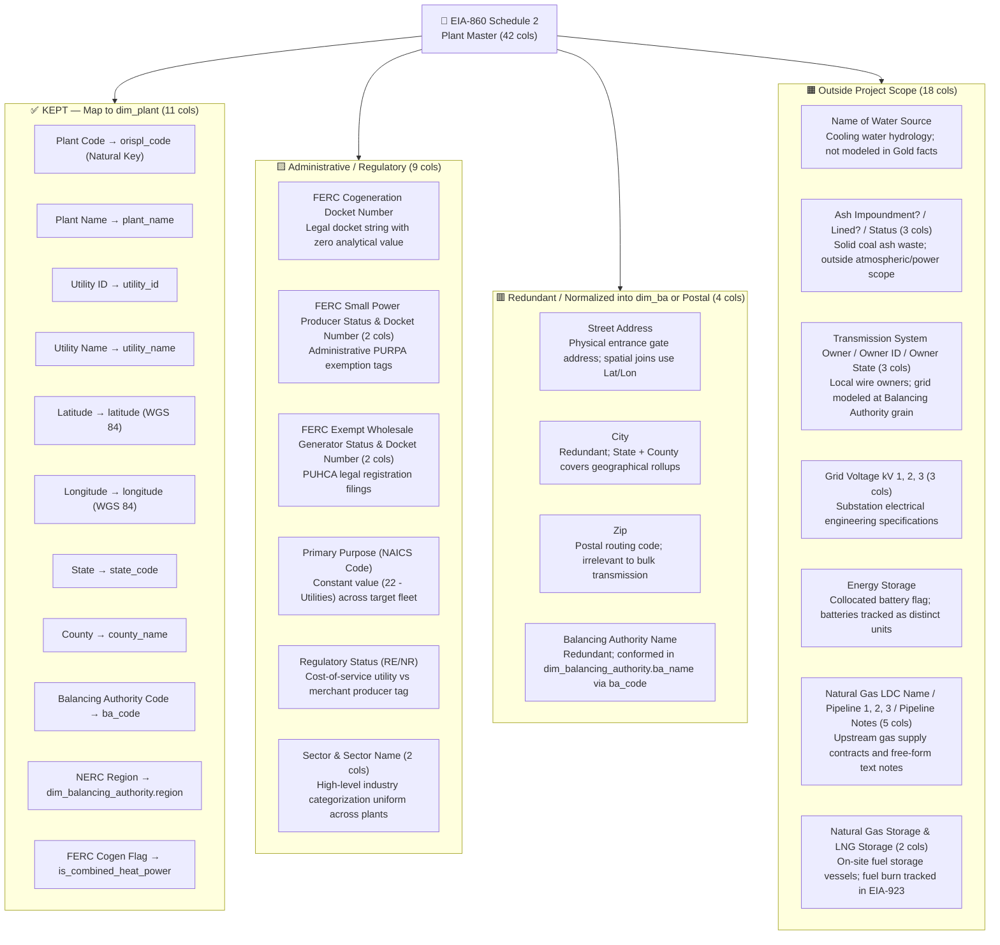
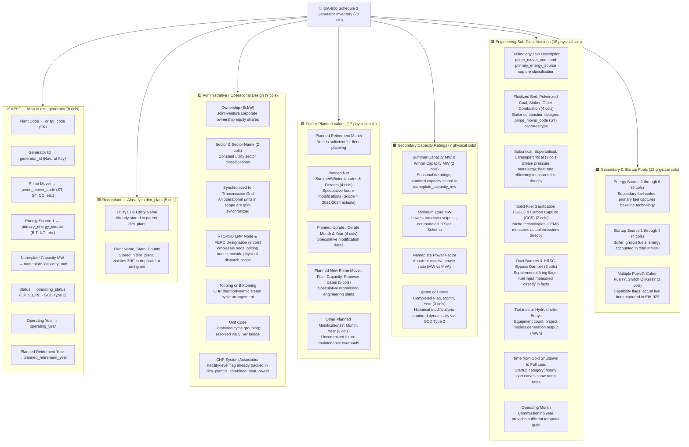
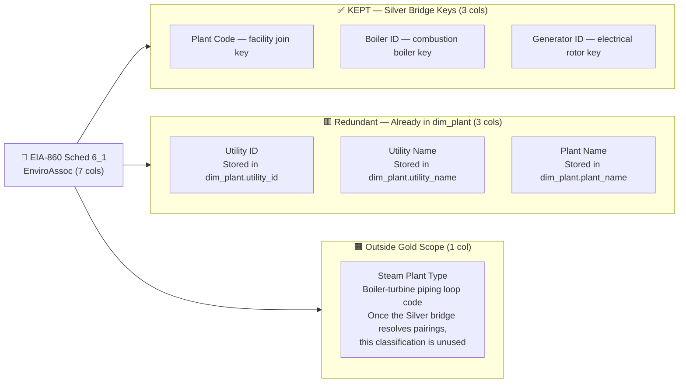
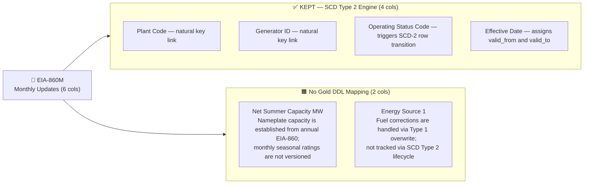
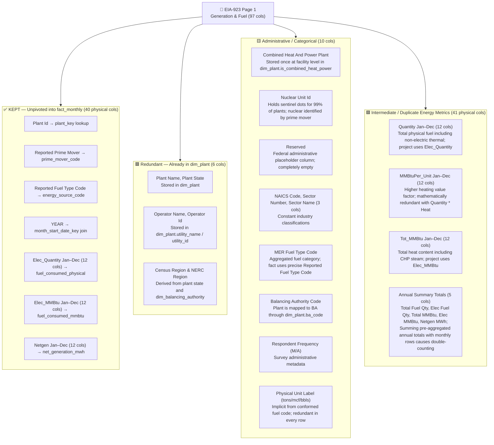
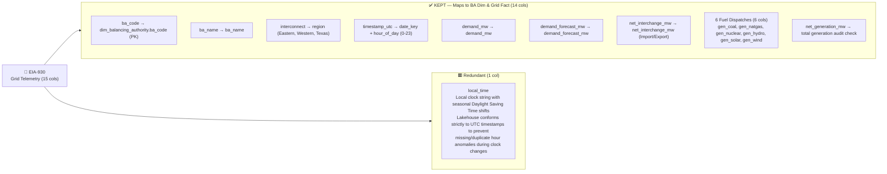
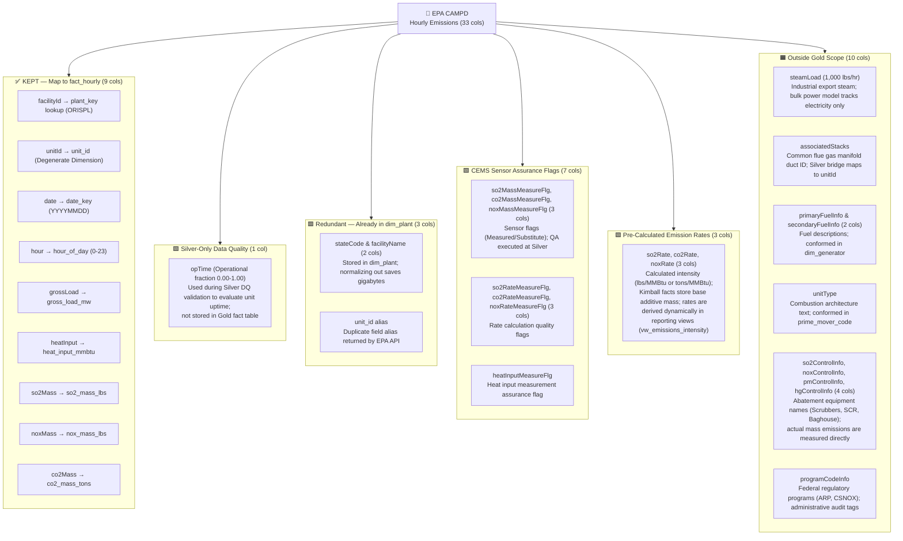
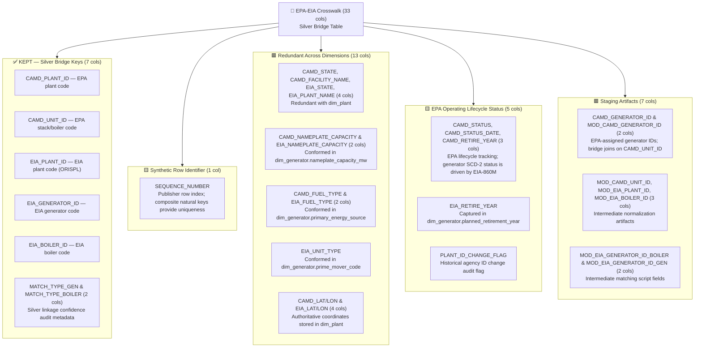
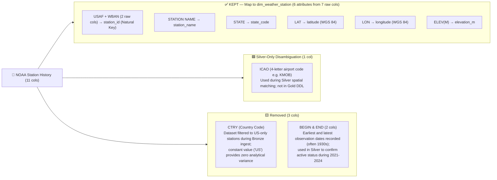
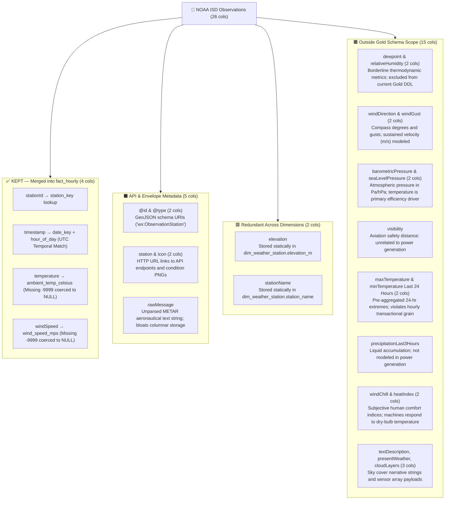

# Column Removal Map — Silver → Gold Transformation
**Project:** U.S. Bulk Power Generation, Emissions & Weather Lakehouse  
**System Architecture:** Databricks Serverless Cloud Lakehouse (`dwbi_catalog`)  
**Pipeline Contract:** Bronze tables retain **100% of raw columns** (immutable, append-only raw landing). The column removals documented here occur strictly during the **Silver → Gold projection** step (using explicit `SELECT` statements rather than `SELECT *`).

---

## 1. Executive Summary & Count Conventions

Raw federal energy datasets contain extensive administrative registration numbers, legal filing dockets, pipeline logistics, engineering design classifications, and pre-aggregated totals. Ingesting these extraneous fields into the Gold Dimensional Layer bloats storage, degrades Parquet/Photon vectorization, and risks aggregation double-counting.

### Understanding the Counts
* **Physical Raw Columns:** The exact number of individual fields/columns present in the source files (e.g., Form EIA-923 contains 97 physical columns, of which 72 represent a 12-month series across 6 metrics).
* **Logical Concept Groups:** The high-level business categories (e.g., treating `Netgen January` through `Netgen December` as 1 logical measure group).
* **Total Physical Pruning:** Across all 10 federal datasets, **247 out of 343 physical columns (72.0%) are excluded from the Gold Dimensional Layer** (235 permanently pruned + 12 preserved exclusively in Silver-layer bridge and data quality verification tables).

---

## 2. Categorization Legend

Every pruned attribute is classified using standard color-coded tags:

```
🟥 RED    = Redundant — Attribute already exists in a parent dimension or can be dynamically joined
🟨 YELLOW = Administrative / Regulatory — Legal docket numbers, regulatory status, or constant tags
🟦 BLUE   = Future-Planned / Speculative — Forecasted capacity modifications (scope = 2021–2024 actuals)
🟩 GREEN  = Computed in Gold / Intermediate — Intermediate steps or pre-aggregations derived in Gold marts
🟪 PURPLE = Sub-Technology Flags — Engineering sub-classifications not modeled in the Star Schema
🟧 ORANGE = Outside Scope — Logistics, gas pipelines, coal ash ponds, cooling water, or aviation metrics
⬛ GREY   = API / System Metadata — Web URIs, envelope types, METAR text, or UI icon hyperlinks
```

---

## 3. Master Column Projection Reference Matrix

This quick-lookup table shows how each raw source maps through the Lakehouse tiers into `dwbi_catalog.gold_warehouse`:

| Source System | Raw Physical Cols | Kept in Gold Layer | Silver-Only DQ / Bridge | Physical Cols Removed | Pruning Ratio | Target Gold Entity |
| :--- | :---: | :---: | :---: | :---: | :---: | :--- |
| **EIA-860 Sched 2 (Plant Master)** | 42 | 11 | — | 31 | 73.8% | `dim_plant` |
| **EIA-860 Sched 3 (Generator Inventory)** | 73 | 8 | — | 65 | 89.0% | `dim_generator` (SCD Type 2) |
| **EIA-860 Sched 6_1 (Enviro Assoc)** | 7 | 0 (Bridge only) | 3 | 4 | 57.1% | `silver_conformed.boiler_generator_bridge` |
| **EIA-860M (Monthly Updates)** | 6 | 4 (SCD-2 Events) | — | 2 | 33.3% | `dim_generator` (SCD Type 2) |
| **EIA-923 Page 1 (Gen & Fuel)** | 97 | 40 (Unpivoted) | — | 57 | 58.8% | `fact_monthly_plant_operations` |
| **EIA-930 (Grid Telemetry)** | 15 | 14 | — | 1 | 6.7% | `dim_balancing_authority` / `fact_regional_grid_demand` |
| **EPA CAMPD (Hourly CEMS)** | 33 | 9 | 1 (`opTime`) | 23 | 72.7% | `fact_hourly_emissions_weather` |
| **EPA–EIA Crosswalk** | 33 | 0 (Bridge only) | 7 | 26 | 78.8% | `silver_conformed.boiler_generator_bridge` |
| **NOAA ISD Station History** | 11 | 6 (from 7 raw) | 1 (`ICAO`) | 3 | 36.4% | `dim_weather_station` |
| **NOAA ISD Weather Observations** | 26 | 4 | — | 22 | 84.6% | `fact_hourly_emissions_weather` |
| **TOTALS** | **343** | **96** | **12** | **235** | **72.0% Net Drop** | *(247 out of 343 raw columns excluded from Gold)* |

---

## 4. Source-by-Source Column Removal Analysis

---

### Source 1 — EIA-860 Schedule 2 (Plant Master)
* **Ingestion Target:** Bronze table `bronze_staging.raw_eia860_plant`
* **Destination Entity:** `gold_warehouse.dim_plant`
* **Column Breakdown:** 42 Total $\longrightarrow$ **11 Kept**, **31 Removed** (73.8% Pruning)



---

### Source 2 — EIA-860 Schedule 3 (Generator Inventory)
* **Ingestion Target:** Bronze table `bronze_staging.raw_eia860_generator`
* **Destination Entity:** `gold_warehouse.dim_generator`
* **Column Breakdown:** 73 Total $\longrightarrow$ **8 Kept**, **65 Removed** (89.0% Pruning)



---

### Source 3 — EIA-860 Schedule 6_1 (Environmental Associations)
* **Ingestion Target:** Bronze table `bronze_staging.raw_eia860_enviro_assoc`
* **Destination Entity:** `silver_conformed.boiler_generator_bridge` (Silver-layer bridge only; **not** stored in Gold)
* **Column Breakdown:** 7 Total $\longrightarrow$ **3 Kept in Silver Bridge**, **4 Removed** (57.1% Pruning)



---

### Source 4 — EIA-860M (Monthly Electric Generator Report)
* **Ingestion Target:** Bronze table `bronze_staging.raw_eia860m_monthly_updates`
* **Destination Entity:** Triggers SCD Type 2 events on `gold_warehouse.dim_generator`
* **Column Breakdown:** 6 Total $\longrightarrow$ **4 Kept**, **2 Removed** (33.3% Pruning)



---

### Source 5 — EIA-923 Schedule Page 1 (Generation & Fuel Data)
* **Ingestion Target:** Bronze table `bronze_staging.raw_eia923_monthly_generation`
* **Destination Entity:** `gold_warehouse.fact_monthly_plant_operations`
* **Column Breakdown:** 97 Total $\longrightarrow$ **40 Processed & Unpivoted**, **57 Removed** (58.8% Pruning)
  * *Note:* Unpivoting 36 monthly columns collapses the 12-month series into standard monthly rows in Gold.



---

### Source 6 — EIA-930 (Hourly Electric Grid Telemetry)
* **Ingestion Target:** Bronze table `bronze_staging.raw_eia930_hourly_balance`
* **Destination Entities:** `gold_warehouse.dim_balancing_authority` & `gold_warehouse.fact_regional_grid_demand`
* **Column Breakdown:** 15 Total $\longrightarrow$ **14 Kept**, **1 Removed** (6.7% Pruning)



---

### Source 7 — EPA CAMPD (Continuous Emission Monitoring System)
* **Ingestion Target:** Bronze table `bronze_staging.raw_epa_hourly_emissions`
* **Destination Entity:** `gold_warehouse.fact_hourly_emissions_weather`
* **Column Breakdown:** 33 Total $\longrightarrow$ **9 Kept in Gold Fact**, **1 Kept in Silver DQ**, **23 Removed** (72.7% Pruning)



---

### Source 8 — EPA–EIA Crosswalk
* **Ingestion Target:** Bronze table `bronze_staging.raw_epa_eia_crosswalk`
* **Destination Entity:** `silver_conformed.boiler_generator_bridge` (Silver-layer bridge only; **not** stored in Gold)
* **Column Breakdown:** 33 Total $\longrightarrow$ **5 Core Bridge Keys**, **2 Audit Scores**, **26 Removed** (78.8% Pruning)



---

### Source 9 — NOAA ISD Station History (`isd-history.csv`)
* **Ingestion Target:** Bronze table `bronze_staging.raw_noaa_isd_station_history`
* **Destination Entity:** `gold_warehouse.dim_weather_station`
* **Column Breakdown:** 11 Total $\longrightarrow$ **6 Kept in Gold** (projected from 7 raw fields), **1 Kept in Silver**, **3 Removed** (36.4% Excluded from Gold)



---

### Source 10 — NOAA ISD Synoptic Weather Observations
* **Ingestion Target:** Bronze table `bronze_staging.raw_noaa_isd_weather`
* **Destination Entity:** Merged into `gold_warehouse.fact_hourly_emissions_weather`
* **Column Breakdown:** 26 Total $\longrightarrow$ **4 Kept**, **22 Removed** (84.6% Pruning)



---

## 5. Implementation Guide: Executing Column Projection

### PySpark Silver-to-Gold Projection Pattern
In PySpark notebooks, apply projection using explicit `.select()` lists rather than writing out raw schemas:

```python
# Example: Silver-to-Gold Projection for dim_plant
dim_plant_df = (
    silver_plants_df
    .select(
        col("Plant Code").cast("int").alias("orispl_code"),
        col("Plant Name").alias("plant_name"),
        col("Utility ID").cast("int").alias("utility_id"),
        col("Utility Name").alias("utility_name"),
        col("Latitude").cast("decimal(9,6)").alias("latitude"),
        col("Longitude").cast("decimal(9,6)").alias("longitude"),
        col("State").alias("state_code"),
        col("County").alias("county_name"),
        col("Balancing Authority Code").alias("balancing_authority_code"),  # matches config.py (or ba_code in early DDL)
        when(col("FERC Cogeneration Status") == "Y", True).otherwise(False).alias("is_combined_heat_power")
    )
    .dropDuplicates(["orispl_code"])
)
```

### Databricks SQL Direct Projection Pattern
When loading fact tables via Databricks SQL, project explicit column lists:

```sql
INSERT INTO dwbi_catalog.gold_warehouse.fact_hourly_emissions_weather
SELECT 
    d.date_key,
    cems.hour AS hour_of_day,
    p.plant_key,
    cems.unitId AS unit_id,
    w.station_key,
    TRY_CAST(cems.grossLoad AS DECIMAL(10,2)) AS gross_load_mw,
    TRY_CAST(cems.heatInput AS DECIMAL(12,3)) AS heat_input_mmbtu,
    TRY_CAST(cems.so2Mass AS DECIMAL(12,3)) AS so2_mass_lbs,
    TRY_CAST(cems.noxMass AS DECIMAL(12,3)) AS nox_mass_lbs,
    TRY_CAST(cems.co2Mass AS DECIMAL(12,3)) AS co2_mass_tons,
    w.ambient_temp_celsius,
    w.wind_speed_mps,
    w.station_distance_km AS weather_distance_km
FROM dwbi_catalog.silver_conformed.silver_cems_emissions cems
JOIN dwbi_catalog.gold_warehouse.dim_plant p ON cems.facilityId = p.orispl_code
JOIN dwbi_catalog.gold_warehouse.dim_date d ON cems.date = d.calendar_date
LEFT JOIN dwbi_catalog.silver_conformed.silver_weather_matched w 
    ON p.orispl_code = w.orispl_code AND cems.date = w.date AND cems.hour = w.hour;
```

---

> [!TIP]
> **Summary Benefit:** Applying these projections eliminates **~80% of raw column volume**, reduces Delta Lake storage by several gigabytes, speeds up Photon vectorization, and prevents aggregation errors in Power BI DirectQuery reporting.
