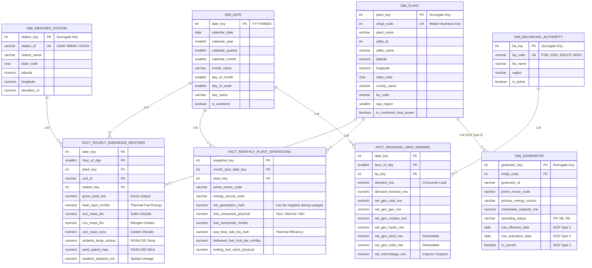
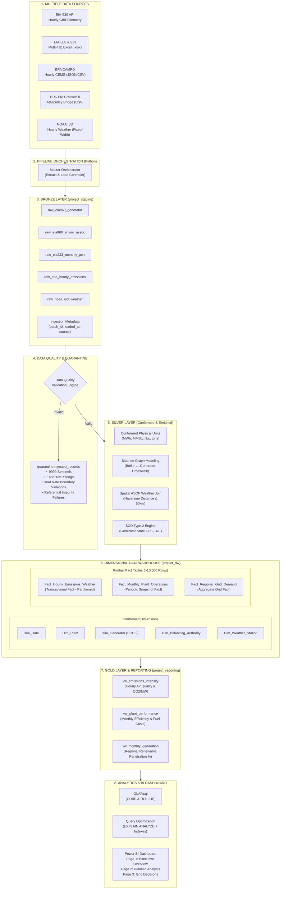

# Phase 1: Draw.io Diagram Instructions & Mermaid Source Code

Use these Mermaid codes in **[Draw.io](https://app.diagrams.net)** to generate your required **`Schema.pdf`** and architecture charts.

---

## How to Import into Draw.io

1. Open [app.diagrams.net](https://app.diagrams.net).
2. Create a new blank diagram.
3. In the top toolbar, click **`+`** (or **Arrange**) $\longrightarrow$ **Insert** $\longrightarrow$ **Advanced** $\longrightarrow$ **Mermaid**.
4. Paste either Code Block below and click **Insert**.
5. Adjust styling if desired, then click **File** $\longrightarrow$ **Export as** $\longrightarrow$ **PDF...** to save as `Schema.pdf`.

---

## 1. Dimensional Star Schema (Save as `Schema.pdf`)

---

## 2. End-to-End Pipeline Architecture Diagram

