# Databricks Serverless Lakehouse Architecture Specification
## DL3004 Data Warehousing & Business Intelligence (DWBI) Final Project

> **System Overview:**  
> This document defines the **end-to-end cloud data lakehouse architecture** for the U.S. Bulk Power Generation, Smokestack Emissions & Synoptic Weather analytics platform. The solution is implemented on **Databricks Serverless Compute** powered by **Apache Spark**, **Delta Lake**, **Unity Catalog**, and **Microsoft Power BI Desktop**.

---

## 1. Executive Technology Stack

| Layer | Technology | Operational Mode / Engine | Purpose in Project |
| :--- | :--- | :--- | :--- |
| **Cloud Lakehouse Platform** | Databricks (`databricks.com`) | Managed Cloud Workspace | Unified platform for data engineering, governance, and SQL analytics. |
| **Processing Engine** | **Apache Spark 3.5+ / 4.x** | **Serverless Notebook Compute (Photon Engine)** | Distributed, in-memory data processing, Excel/CSV extraction, and SCD transformation. |
| **Warehouse & Query Engine**| **Databricks SQL (DB SQL)** | **Serverless SQL Warehouse** | Low-latency SQL query execution, analytical views, and live BI connectivity. |
| **Storage & Table Format** | **Delta Lake** | Open Parquet + ACID Transaction Log (`_delta_log`) | ACID transactions, time travel (`VERSION AS OF`), schema evolution, and Liquid Clustering. |
| **Unified Governance & Lineage**| **Unity Catalog** | 3-Tier Namespace (`catalog.schema.table`) | Centralized data governance, file landing volumes, column-level lineage, and data contracts. |
| **Raw Storage Landing** | **Unity Catalog Volumes** | Managed / External Storage Volume | File-level landing zone for multi-source raw files (Excel, CSV, JSON). |
| **Data Transformation (ELT)**| **PySpark & Databricks SQL** | Delta `MERGE INTO` & Serverless Pipelines | Automated Medallion processing (Bronze $\to$ Silver $\to$ Gold) and SCD Type 1 & 2. |
| **Business Intelligence (BI)** | **Microsoft Power BI Desktop** | Native Databricks Connector (DirectQuery / Import) | Executive dashboards, efficiency scatter plots, and weather-grid correlation visuals. |

---

## 2. Unity Catalog Structure (3-Tier Namespace)

All data assets are governed under a dedicated catalog: **`dwbi_catalog`**.

```
dwbi_catalog/
├── Volumes/
│   └── bronze_staging/
│       └── raw_landing/                     # Landing zone for raw EIA, EPA, NOAA files
│
├── Schemas (Databases):
│   ├── bronze_staging                       # Raw append-only Delta tables with metadata
│   ├── silver_conformed                     # Conformed, cleansed, deduplicated tables
│   ├── gold_warehouse                       # Kimball Star Schema (5 Dims + 3 Multi-Grain Facts)
│   ├── gold_marts                           # Materialized reporting views for Power BI
│   └── quarantine                           # Dead-letter quarantine table for rejected rows
```

### 2.1 Schema Definitions & Data Flow

```mermaid
flowchart LR
    subgraph Sources["Raw Files (EIA, EPA, NOAA)"]
        F1["EIA-860 / 923 (.xlsx)"]
        F2["EPA CAMPD (.csv)"]
        F3["NOAA Weather (.csv)"]
    end

    subgraph Volumes["Unity Catalog Volume"]
        V["/Volumes/dwbi_catalog/bronze_staging/raw_landing/"]
    end

    subgraph Bronze["1. Bronze Layer (raw append-only)"]
        B1["raw_eia860_generators"]
        B2["raw_eia923_generation"]
        B3["raw_epa_campd_cems"]
        B4["raw_noaa_weather"]
    end

    subgraph Silver["2. Silver Layer (conformed & validated)"]
        S1["silver_plants_generators (SCD 1 & 2)"]
        S2["silver_emissions_cems"]
        S3["silver_grid_demand"]
        Q["quarantine.rejected_records"]
    end

    subgraph Gold["3. Gold Layer (Kimball Star Schema)"]
        D["Conformed Dimensions\n(dim_date, dim_plant, dim_generator, dim_weather)"]
        F["Multi-Grain Facts\n(fact_hourly_emissions, fact_monthly_gen, fact_grid_stress)"]
    end

    subgraph Marts["4. Gold Marts & Power BI"]
        M["Analytical Views\n(vw_emissions_intensity, vw_heat_rate_anomalies)"]
        PBI["Power BI Desktop (DirectQuery)"]
    end

    Sources --> V
    V -->|PySpark Extractors| Bronze
    Bronze -->|Cleanse & Validate| Silver
    Bronze -.->|Rejection Rules| Q
    Silver -->|Surrogate Key Mapping| Gold
    Gold --> Marts
    Marts --> PBI
```



---

## 3. Database & Connection Configuration

### 3.1 Databricks Serverless SQL Warehouse Connection
Power BI Desktop and external development environments connect directly to the Databricks Serverless SQL Warehouse.

* **Connector:** Microsoft Power BI Native **Databricks Connector** (`Get Data -> Databricks`).
* **Server Hostname:** `dbc-xxxxxxxx-xxxx.cloud.databricks.com`
* **HTTP Path:** `/sql/1.0/warehouses/xxxxxxxxxxxxxxxx`
* **Port:** `443`
* **Default Catalog:** `dwbi_catalog`
* **Default Database / Schema:** `gold_marts` (or `gold_warehouse`)
* **Authentication:** Azure AD / Databricks Personal Access Token (PAT) / OAuth.
* **Connection Mode:** 
  * **DirectQuery:** For real-time, live querying off the Serverless SQL Warehouse.
  * **Import:** For high-speed in-memory caching of dimensional tables and data marts.

### 3.2 Python / Databricks Connect Configuration (Optional Local Execution)
```python
from databricks.connect import DatabricksSession

# Connect local Python code directly to Databricks Serverless compute
spark = DatabricksSession.builder.serverless().getOrCreate()
df = spark.read.table("dwbi_catalog.gold_warehouse.fact_hourly_emissions")
df.show(5)
```

---

## 4. Architectural Rules & Real-World Gotchas Handled

### 4.1 Dynamic Header Discovery (Shifting Excel Layouts)
* **EIA-860:** Header row is located on **Row 2** (Row 1 contains workbook title).
* **EIA-923:** Header row is located on **Row 6** (Rows 1–3 metadata, Row 4 blank, Row 5 merged categories).
* **Lakehouse Rule:** Ingestion scripts must programmatically scan the initial 10 rows for string identifiers (`'Plant Code'` or `'Plant Id'`) to determine the schema offset dynamically rather than using hardcoded row indices.

### 4.2 Sentinel Value Coercion
* **EIA Feeds:** Literal strings `"."` and `"NM"` (Not Meaningful) are converted to SQL `NULL`.
* **NOAA Weather Feeds:** Integer `-9999` (missing sensor measurement) is converted to SQL `NULL`. Single-character quality flags (`Z`, `T`) are extracted into dedicated indicator attributes.

### 4.3 Negative Generation (Auxiliary Power Consumption)
* Real-world power plants consume station electricity during maintenance or downtime. Negative net generation in EIA-923 (e.g., `-3,555 MWh`) is **valid business data** and must not be rejected by data quality checks.

### 4.4 Liquid Clustering (Physical Performance Optimization)
Instead of legacy database table partitioning and manual B-Tree index rebuilding, Delta Lake tables utilize **Liquid Clustering**:
```sql
ALTER TABLE dwbi_catalog.gold_warehouse.fact_hourly_emissions 
CLUSTER BY (orispl_code, date_key);
```
This enables automatic partition pruning, Z-order data skipping, and sub-second query performance for Power BI DirectQuery visuals.

---

## 5. Slowly Changing Dimension (SCD) Policy

* **SCD Type 1 (Overwrites):** Applied to facility names, utility owners, state codes, and geographic latitude/longitude in `dim_plant`. Changes overwrite previous values directly.
* **SCD Type 2 (Historical Tracking):** Applied to generator operational status (`Operating`, `Standby`, `Out of Service`, `Retired`) and nameplate capacity in `dim_generator`.
  * Tracked using: `generator_key` (Surrogate Key), `valid_from` (TIMESTAMP), `valid_to` (TIMESTAMP), and `is_current` (BOOLEAN).
  * Implemented via Delta Lake atomic **`MERGE INTO`** operations.

---

## 6. The 4-Person Division of Work (Ready for Assignment)

The project workload is split into four decoupled, modular work packages. Each member owns one architectural tier end-to-end:

### Work Package 1: Ingestion & Bronze Lakehouse Lead
* **Scope:** Volume creation, multi-source raw file landing, and PySpark Bronze extractors.
* **Deliverables:**
  * Volume setup: `/Volumes/dwbi_catalog/bronze_staging/raw_landing/`.
  * PySpark notebooks for EIA-860, EIA-923, EPA CAMPD, and NOAA ISD.
  * Ingestion audit log: `dwbi_catalog.bronze_staging.etl_run_log`.
* **Viva Focus:** Automated multi-source extraction, shifting header row discovery, and immutable Bronze Delta tables.

### Work Package 2: Data Quality & Silver Conformance Lead
* **Scope:** Cleansing pipelines, sentinel coercion, dead-letter quarantine, and SCD Type 1 & 2 logic.
* **Deliverables:**
  * Cleanse notebooks: converting `"."`, `"NM"`, and `-9999` to `NULL`.
  * Dead-letter table: `dwbi_catalog.quarantine.rejected_records`.
  * SCD Type 2 PySpark/SQL Delta `MERGE INTO` pipeline for `dim_generator`.
  * Written **Data Cleaning & Data Quality Report (PDF)** for Phase 2 submission.
* **Viva Focus:** Defensive data validation, dead-letter quarantine pattern, and atomic SCD Type 2 merges.

### Work Package 3: Dimensional Warehouse & Gold Layer Architect
* **Scope:** Kimball Star Schema DDL, surrogate key lookups, 3 multi-grain fact tables, and Liquid Clustering.
* **Deliverables:**
  * DDL for 5 Conformed Dimensions (`dim_date`, `dim_plant`, `dim_generator`, `dim_weather_station`, `dim_balancing_authority`).
  * Pipelines for 3 Fact tables (`fact_hourly_emissions`, `fact_monthly_generation`, `fact_hourly_grid_stress`).
  * Liquid Clustering optimization and query execution plan benchmarking.
* **Viva Focus:** Kimball dimensional design, handling multi-grain facts, surrogate key mapping, and storage optimization.

### Work Package 4: Analytics, OLAP, Power BI & Performance Lead
* **Scope:** Gold Reporting Marts, OLAP SQL (`ROLLUP`/`CUBE`), Power BI Desktop dashboard, and final reconciliation.
* **Deliverables:**
  * Materialized views in `dwbi_catalog.gold_marts`: Emissions Intensity, Heat Rate Efficiency, and Weather Stress.
  * Analytical SQL queries: Window functions (`LAG`/`LEAD`), `ROLLUP`, and `CUBE`.
  * 3-Page Power BI Report (`PowerBI.pbix`): Executive Overview, Plant Deep Dive, and Weather Stress Decision Support.
  * Lineage diagrams (Unity Catalog export) and final presentation deck.
* **Viva Focus:** DirectQuery Power BI performance, OLAP dimensional slicing, and energy grid analytical insights.

---

## 7. Master Execution Runbook

### Step 1: Initial DDL (Run in Databricks SQL / Notebook)
```sql
-- 1. Create Catalog & Schemas
CREATE CATALOG IF NOT EXISTS dwbi_catalog;
USE CATALOG dwbi_catalog;

CREATE SCHEMA IF NOT EXISTS bronze_staging;
CREATE SCHEMA IF NOT EXISTS silver_conformed;
CREATE SCHEMA IF NOT EXISTS gold_warehouse;
CREATE SCHEMA IF NOT EXISTS gold_marts;
CREATE SCHEMA IF NOT EXISTS quarantine;

-- 2. Create Landing Volume for Raw Files
CREATE VOLUME IF NOT EXISTS bronze_staging.raw_landing;

-- 3. Create Audit Run Log Table
CREATE TABLE IF NOT EXISTS bronze_staging.etl_run_log (
    run_id BIGINT GENERATED ALWAYS AS IDENTITY,
    batch_id STRING NOT NULL,
    pipeline_step STRING NOT NULL,
    source_system STRING NOT NULL,
    records_read INT,
    records_inserted INT,
    records_rejected INT,
    execution_status STRING,
    start_time TIMESTAMP,
    end_time TIMESTAMP,
    error_message STRING
) USING DELTA;

-- 4. Create Dead-Letter Quarantine Table
CREATE TABLE IF NOT EXISTS quarantine.rejected_records (
    rejection_id BIGINT GENERATED ALWAYS AS IDENTITY,
    batch_id STRING NOT NULL,
    source_system STRING NOT NULL,
    source_table STRING NOT NULL,
    rejection_reason STRING NOT NULL,
    raw_payload_json STRING NOT NULL,
    rejected_at TIMESTAMP DEFAULT CURRENT_TIMESTAMP()
) USING DELTA;
```

### Step 2: Upload Raw Source Files to Volume
Files are uploaded directly into `/Volumes/dwbi_catalog/bronze_staging/raw_landing/` via the Databricks UI (Catalog $\to$ Volumes) or Databricks CLI.

### Step 3: Run Extraction & Processing Notebooks
Run the Serverless PySpark notebooks sequentially:
1. `01_bronze_ingestion.py`
2. `02_silver_cleansing_and_scd.py`
3. `03_gold_star_schema_facts.py`
4. `04_gold_reporting_marts.py`

### Step 4: Connect Power BI Desktop
1. Open Power BI Desktop $\to$ **Get Data** $\to$ **Databricks**.
2. Supply Serverless SQL Warehouse hostname and HTTP path.
3. Select `dwbi_catalog.gold_marts` and `dwbi_catalog.gold_warehouse`.
4. Build the visuals and save as `06_Dashboard/PowerBI.pbix`.

