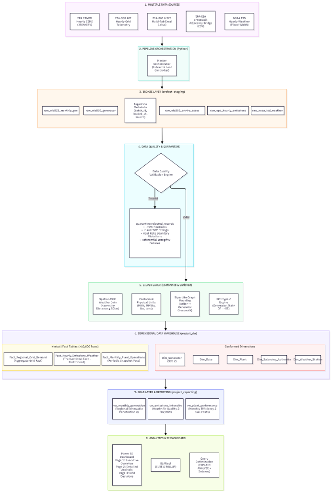
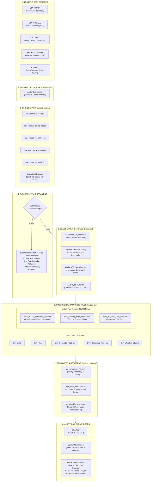
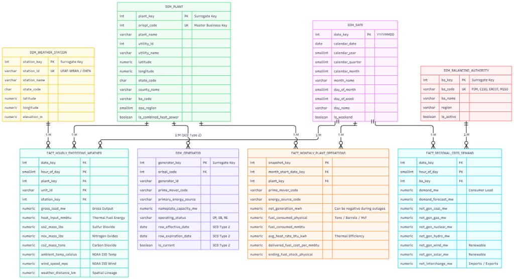
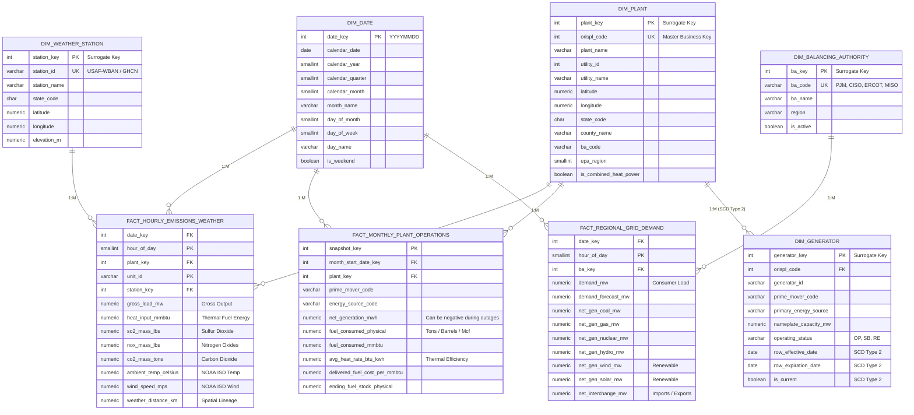

# Phase 1 Architecture and Schema Specification

**Project:** U.S. Bulk Power Generation, Smokestack Air Emissions, and Synoptic Weather Warehouse
**Course:** DL3004 Data Warehousing & Business Intelligence (DWBI), Fall 2026
**Institution:** FAST National University of Computer and Emerging Sciences
**Phase:** 1 (Design)
**Related files:** `Architecture_Pipeline_Diagram.png`, `Schema_Diagram.jpg`, `Phase_1_Data_Dictionary.md`, `Data_Dictionary.xlsx`

---

## 1. Purpose

This document is the technical design of the warehouse. It specifies the end-to-end pipeline architecture (Section 2), how it maps to the course reference architecture (Section 3), the dimensional model (Sections 4 to 7), the physical DDL (Section 9), and the validation formulas the data quality engine applies (Section 8). Phase 2 implements this design and Phase 3 builds analytics on top of it.

---

## 2. Pipeline Architecture



*Figure 1. End-to-end pipeline: sources, orchestration, Bronze, data quality and quarantine, Silver, dimensional warehouse, Gold reporting, and analytics and BI.*

### 2.1 Stage Descriptions

| # | Stage | Schema / Tool | What happens | Output |
| :-: | :--- | :--- | :--- | :--- |
| 1 | Multiple data sources | EIA-930 API, EIA-860 and EIA-923 Excel workbooks, EPA CAMPD JSON/CSV, EPA-EIA crosswalk CSV, NOAA ISD fixed-width files | Public files and APIs that differ in format and grain | Raw files in `02_Data/raw_data` |
| 2 | Pipeline orchestration | Python (`pandas`, `requests`, `psycopg2`) | A master orchestrator runs the sequence: ingest, validate, transform, load dimensions, load facts, build marts, test and reconcile, log run | One `batch_id` per run |
| 3 | Bronze layer | `project_staging` | Lands each source as raw, text-typed tables with `batch_id`, `ingested_at`, and source system; nothing is dropped | `raw_eia860_generator`, `raw_eia860_enviro_assoc`, `raw_eia923_monthly_generation`, `raw_epa_hourly_emissions`, `raw_noaa_isd_weather` |
| 4 | Data quality and quarantine | SQL validation engine, `quarantine` schema | Checks sentinels, types, nulls, duplicates, business rules, and referential integrity. Invalid rows go to `quarantine.rejected_records`; valid rows continue | Clean stream plus a rejection log |
| 5 | Silver layer | Python and SQL | Conforms units (MWh, MMBtu, lbs, tons), models the boiler-to-generator crosswalk as a bipartite graph, joins weather to plants by nearest station and nearest hour, and runs SCD Type 2 detection for generator status | Cleaned, conformed data in `02_Data/cleaned_data` |
| 6 | Dimensional data warehouse | `project_dw` | Five conformed dimensions and three Kimball fact tables, with surrogate keys. The hourly emissions fact is partitioned | `dim_*`, `fact_*` |
| 7 | Gold layer and reporting | `project_reporting` | Business-facing views that aggregate facts to the grain of each dashboard visual | `vw_emissions_intensity`, `vw_plant_performance`, `vw_monthly_generation` |
| 8 | Analytics and BI | SQL, Power BI Desktop | OLAP queries (`ROLLUP`, `CUBE`), window functions, `EXPLAIN ANALYZE` tuning, and a three-page dashboard | `OLAP.sql`, `Views.sql`, `PowerBI.pbix` |

### 2.2 Technology Stack

| Concern | Tool |
| :--- | :--- |
| Database and warehouse engine | PostgreSQL 16+ on `localhost:5432` |
| ETL and data engineering | Python 3.10+ with `pandas`, `openpyxl`, `requests`, `psycopg2` |
| Business intelligence | Microsoft Power BI Desktop |
| Modeling and diagrams | Draw.io and Markdown |
| Version control | GitHub |

The whole stack is free and runs locally, as the course requires. All logic is kept as reproducible SQL and Python scripts.

### 2.3 Diagram Source (Mermaid)

The diagram above can be regenerated from this source (GitHub and VS Code render it; Draw.io imports it through *Arrange, Insert, Advanced, Mermaid*).



---

## 3. Mapping to the Course Reference Architecture

The course provides an 11-component reference architecture (`Sample Project Architecture Diagram.png`). Every component is covered. Components 7, 10, and 11 are cross-cutting capabilities rather than boxes in the pipeline diagram.

| # | Course component | Implementation in this project |
| :-: | :--- | :--- |
| 1 | Multiple data sources | Stage 1: EIA-860, EIA-923, EIA-930, EPA CAMPD, EPA-EIA crosswalk, NOAA ISD |
| 2 | Pipeline orchestration | Stage 2: Python master orchestrator, ingest through log run |
| 3 | Bronze layer (raw and landing) | Stage 3: `project_staging.raw_*` with ingestion metadata |
| 4 | Data quality, validation, reject and quarantine | Stage 4: `quarantine.rejected_records` with reason, source, batch, and timestamp |
| 5 | Silver layer (cleaned and standardized) | Stage 5: unit conformance, deduplication, watermark-based incremental logic |
| SCD | SCD processing | Stage 5 detects changes; `dim_generator` is Type 2, `dim_plant` is Type 1 |
| 6 | Dimensional data warehouse | Stage 6: star schema with transactional, periodic snapshot, and aggregate grid facts |
| 7 | Warehouse performance | Range partitioning of the hourly emissions fact, B-tree indexes on foreign keys and dates, and `EXPLAIN ANALYZE` before and after (Phase 3) |
| 8 | Gold layer and data marts | Stage 7: three reporting views |
| 9 | Analytics and BI | Stage 8: analytical SQL, `ROLLUP`, `CUBE`, window functions, Power BI |
| 10 | Audit, monitoring, and reconciliation | `project_staging.etl_run_log` records rows read, inserted, updated, and rejected per step. Reconciliation compares EPA gross generation to EIA net generation (Section 8.2) |
| 11 | Metadata and data lineage | The data dictionary plus `batch_id` and `ingested_at` on every Bronze row trace source to Bronze to Silver to warehouse to Gold to Power BI |

---

## 4. Dimensional Model



*Figure 2. Dimensional model: five dimensions and three fact tables.*

The model follows Kimball's four design steps: choose the business process, declare the grain, identify the dimensions, and identify the facts (Kimball & Ross, 2013).

### 4.1 Bus Matrix

| Business process | Fact table | Archetype | Date | Plant | Balancing authority | Weather station |
| :--- | :--- | :--- | :-: | :-: | :-: | :-: |
| Hourly smokestack emissions and weather | `fact_hourly_emissions_weather` | Transactional | ✓ | ✓ | | ✓ |
| Monthly plant fuel use and net generation | `fact_monthly_plant_operations` | Periodic snapshot | ✓ | ✓ | | |
| Hourly grid demand and dispatch | `fact_regional_grid_demand` | Aggregate grid | ✓ | | ✓ | |

`dim_generator` is an outrigger of `dim_plant` (Section 5.3) and is not a direct fact dimension. `dim_date` is conformed across all three facts, and `dim_plant` across the two plant-level facts. A plant's `ba_code` attribute matches `dim_balancing_authority.ba_code`, which lets a report compare plant-level emissions with grid-level demand for the same balancing authority and hour (drill-across).

### 4.2 Grain Declarations

| Fact table | Grain (one row per...) | Primary key |
| :--- | :--- | :--- |
| `fact_hourly_emissions_weather` | generating unit (`unit_id`) at a plant, per clock hour | `(date_key, hour_of_day, plant_key, unit_id)` |
| `fact_monthly_plant_operations` | plant, prime mover, and energy source, per calendar month | `snapshot_key` |
| `fact_regional_grid_demand` | balancing authority, per clock hour | `(date_key, hour_of_day, ba_key)` |

### 4.3 Measures and Additivity

| Fact table | Measure | Additivity |
| :--- | :--- | :--- |
| Hourly emissions | `gross_load_mw`, `heat_input_mmbtu`, `so2_mass_lbs`, `nox_mass_lbs`, `co2_mass_tons` | Additive across units, plants, and hours |
| Hourly emissions | `ambient_temp_celsius`, `wind_speed_mps`, `weather_distance_km` | Non-additive; averaged |
| Monthly operations | `net_generation_mwh`, `fuel_consumed_mmbtu` | Additive |
| Monthly operations | `fuel_consumed_physical` | Additive only within one unit of measure (tons, barrels, or Mcf) |
| Monthly operations | `avg_heat_rate_btu_kwh`, `delivered_fuel_cost_per_mmbtu` | Non-additive ratios; recomputed from summed numerators and denominators |
| Monthly operations | `ending_fuel_stock_physical` | Semi-additive; not summed across months |
| Grid demand | `demand_mw`, `demand_forecast_mw`, `net_gen_*_mw`, `net_interchange_mw` | Additive across balancing authorities for the same hour; averaged across time |

### 4.4 Relationships

| Parent | Child | Cardinality | Join column(s) |
| :--- | :--- | :--- | :--- |
| `dim_date` | `fact_hourly_emissions_weather` | 1 : M | `date_key` |
| `dim_date` | `fact_monthly_plant_operations` | 1 : M | `month_start_date_key` to `date_key` |
| `dim_date` | `fact_regional_grid_demand` | 1 : M | `date_key` |
| `dim_plant` | `fact_hourly_emissions_weather` | 1 : M | `plant_key` |
| `dim_plant` | `fact_monthly_plant_operations` | 1 : M | `plant_key` |
| `dim_plant` | `dim_generator` | 1 : M | `orispl_code` |
| `dim_balancing_authority` | `fact_regional_grid_demand` | 1 : M | `ba_key` |
| `dim_weather_station` | `fact_hourly_emissions_weather` | 1 : M | `station_key` |

### 4.5 Diagram Source (Mermaid)



---

## 5. Dimension Design

### 5.1 Surrogate and Business Keys

Every dimension has an integer surrogate key and keeps its business key as a separate column. Facts store only surrogate keys. `dim_date.date_key` is a smart key (`YYYYMMDD`), which is standard for a date dimension and keeps partition ranges readable.

| Dimension | Surrogate key | Business key |
| :--- | :--- | :--- |
| `dim_date` | `date_key` | `calendar_date` |
| `dim_plant` | `plant_key` | `orispl_code` |
| `dim_generator` | `generator_key` | `orispl_code`, `generator_id` (versioned by `row_effective_date`) |
| `dim_balancing_authority` | `ba_key` | `ba_code` |
| `dim_weather_station` | `station_key` | `station_id` |

Each dimension also carries an *Unknown / Not applicable* member with key `-1`, so a late-arriving or unmatched business key does not drop a fact row.

### 5.2 Slowly Changing Dimension Policy

| Dimension | Type | Tracked attributes | Behavior |
| :--- | :--- | :--- | :--- |
| `dim_plant` | Type 1 | `plant_name`, `utility_name`, `county_name`, and other descriptive attributes | Overwrite in place; corrections do not need history |
| `dim_weather_station` | Type 1 | Station name, coordinates, elevation | Overwrite |
| `dim_balancing_authority` | Type 1 | `ba_name`, `region`, `is_active` | Overwrite |
| `dim_generator` | **Type 2** | `operating_status` (OP, SB, OA, RE) and `nameplate_capacity_mw` | Expire the current row and insert a new version |
| `dim_date` | Static | None | Generated once |

SCD Type 2 handling for `dim_generator` (illustrative; the working table `silver_generator` is the cleaned Silver output):

```sql
-- Step 1: expire the current version when a tracked attribute changed
UPDATE project_dw.dim_generator d
SET    row_expiration_date = CURRENT_DATE - 1,
       is_current          = FALSE
FROM   silver_generator s
WHERE  d.orispl_code  = s.orispl_code
  AND  d.generator_id = s.generator_id
  AND  d.is_current
  AND (d.operating_status      IS DISTINCT FROM s.operating_status
    OR d.nameplate_capacity_mw IS DISTINCT FROM s.nameplate_capacity_mw);

-- Step 2: insert a new current version (also inserts brand-new generators)
INSERT INTO project_dw.dim_generator
       (orispl_code, generator_id, prime_mover_code, primary_energy_source,
        nameplate_capacity_mw, operating_status,
        row_effective_date, row_expiration_date, is_current)
SELECT  s.orispl_code, s.generator_id, s.prime_mover_code, s.primary_energy_source,
        s.nameplate_capacity_mw, s.operating_status,
        CURRENT_DATE, DATE '9999-12-31', TRUE
FROM    silver_generator s
LEFT JOIN project_dw.dim_generator d
       ON d.orispl_code = s.orispl_code
      AND d.generator_id = s.generator_id
      AND d.is_current
WHERE   d.generator_key IS NULL;
```

SCD Type 1 handling for `dim_plant`:

```sql
INSERT INTO project_dw.dim_plant (orispl_code, plant_name, utility_id, utility_name,
                                  latitude, longitude, state_code, county_name,
                                  ba_code, epa_region, is_combined_heat_power)
SELECT orispl_code, plant_name, utility_id, utility_name,
       latitude, longitude, state_code, county_name,
       ba_code, epa_region, is_combined_heat_power
FROM   silver_plant
ON CONFLICT (orispl_code) DO UPDATE
SET    plant_name   = EXCLUDED.plant_name,
       utility_name = EXCLUDED.utility_name,
       county_name  = EXCLUDED.county_name,
       ba_code      = EXCLUDED.ba_code;
```

### 5.3 Design Decisions and Trade-offs

1. **Three facts at three grains, not one wide fact.** EIA-930 is published per balancing authority, while EPA CAMPD is per stack unit and EIA-923 is per plant, prime mover, and fuel. Forcing them into one grain would invent precision the sources do not have. The conformed `dim_date` and the `ba_code` attribute on `dim_plant` connect the facts for drill-across analysis.
2. **`dim_generator` is an outrigger of `dim_plant`.** EPA hourly data is at boiler or stack unit grain and EIA-923 is at plant and prime-mover grain, so neither fact can carry a single generator key. The many-to-many boiler-to-generator relationship is resolved in Silver with the EPA-EIA crosswalk, modeled as a bipartite graph, which prevents a Cartesian product. If Phase 3 needs unit-level generator attributes, the crosswalk can be added as a bridge table.
3. **No inner join between generation and boiler data.** In the profiled data, most plants in EIA-923 have no boiler record, because hydro, wind, and solar plants have no combustion boilers. Non-thermal plants therefore bypass the boiler association and use the unknown member where a boiler attribute is needed.
4. **Negative net generation is valid.** A plant that is offline draws station power from the grid, so `net_generation_mwh` is allowed to be negative. These rows are kept and flagged, not rejected.
5. **Hour of day is stored in the fact, not in a separate time dimension.** `hour_of_day` (0 to 23) has no descriptive attributes beyond its value. A `dim_time` can be added later without changing the grain.
6. **The hourly emissions fact is range-partitioned on `date_key`.** Monthly partitions keep scans small and let `EXPLAIN ANALYZE` show partition pruning in Phase 3.
7. **Weather is attached by nearest station and nearest hour.** Plants have no weather station of their own. `weather_distance_km` stores the match distance as lineage so analysts can judge how representative the weather value is. A row with no station within 50 km keeps null weather measures and is counted in the data quality report.

### 5.4 Partitioning Sketch (Phase 2)

```sql
CREATE TABLE project_dw.fact_hourly_emissions_weather_2023_01
    PARTITION OF project_dw.fact_hourly_emissions_weather
    FOR VALUES FROM (20230101) TO (20230201);
```

---

## 6. Reporting Layer

| View | Source fact | Grain | Key measures |
| :--- | :--- | :--- | :--- |
| `vw_emissions_intensity` | `fact_hourly_emissions_weather` | Plant per day | Gross load, CO2, SO2, NOx, CO2 intensity, average ambient temperature |
| `vw_plant_performance` | `fact_monthly_plant_operations` | Plant, prime mover, and fuel per month | Net generation, fuel MMBtu, average heat rate, delivered fuel cost, outage indicator |
| `vw_monthly_generation` | `fact_regional_grid_demand` | Balancing authority per month | Average and peak demand, generation by fuel, renewable penetration percent |

---

## 7. Layer-to-Schema Summary

| Layer | PostgreSQL schema | Tables |
| :--- | :--- | :--- |
| Bronze | `project_staging` | 5 `raw_*` tables, `etl_run_log` |
| Quarantine | `quarantine` | `rejected_records` |
| Warehouse | `project_dw` | 5 dimensions, 3 facts |
| Gold | `project_reporting` | 3 views |

---

## 8. Validation and Calculation Rules

### 8.1 Technology-Specific Heat Rate Bounds

Heat rate measures thermal efficiency:

```text
Heat Rate (Btu/kWh) = Fuel Consumed (MMBtu) x 1,000 / Net Generation (MWh)
```

A single universal efficiency limit would reject valid peaker plants or accept impossible combined-cycle values, so the bounds depend on the technology.

| Technology | Prime mover | Valid heat rate (Btu/kWh) | Rejection code |
| :--- | :--- | :--- | :--- |
| Combined cycle | CA, CT, CS, CC | 5,000 to 14,000 | `CCGT_HEAT_RATE_OUT_OF_BOUNDS` |
| Coal steam turbine | ST (BIT, SUB, LIG) | 8,500 to 18,000 | `COAL_ST_HEAT_RATE_OUT_OF_BOUNDS` |
| Simple-cycle gas turbine (peaker) | GT | 9,000 to 22,000 | `PEAKER_GT_HEAT_RATE_OUT_OF_BOUNDS` |

### 8.2 Generation Reconciliation (Net versus Gross)

Net generation (EIA-923) cannot exceed gross generation (EPA CAMPD), because a plant uses part of its output internally.

```text
Auxiliary Load Ratio = 1 - (Net Generation MWh / Gross Generation MWh)
```

| Fuel | Typical ratio |
| :--- | :--- |
| Natural gas | 3% to 10% |
| Coal | 6% to 14% (flue-gas desulfurization scrubbers use power) |

A plant whose net generation exceeds gross by more than 2%, without a combined heat and power steam credit, is flagged as a cross-source discrepancy.

### 8.3 Nearest Weather Station (Haversine)

```text
d = 2R * asin( sqrt( sin^2(dLat/2) + cos(lat1) * cos(lat2) * sin^2(dLon/2) ) )      R = 6,371 km
```

For each plant, the nearest NOAA station within 50 km is selected. The hourly plant record is matched to the closest weather observation within ±60 minutes. The match distance is stored as `weather_distance_km`.

### 8.4 Quality Check Categories (Phase 2 Rubric)

| Category | Check | Example |
| :--- | :--- | :--- |
| Completeness | Missing values in required columns | Count of null `plant_key`, `date_key` after load |
| Accuracy | Totals reconcile between layers and sources | Sum of `co2_mass_tons` in Silver equals the fact table; EPA gross versus EIA net |
| Integrity | Foreign keys resolve | Fact rows without a matching dimension row = 0 |

---

## 9. Physical DDL

### 9.1 Staging and Quarantine (`project_staging`, `quarantine`)

```sql
-- ==============================================================================
-- DL3004 DWBI Final Project: Staging & Quarantine Tables
-- Target Engine: PostgreSQL 14+
-- ==============================================================================

CREATE SCHEMA IF NOT EXISTS project_staging;
CREATE SCHEMA IF NOT EXISTS quarantine;

-- ------------------------------------------------------------------------------
-- 1. ETL AUDIT RUN LOG
-- ------------------------------------------------------------------------------
DROP TABLE IF EXISTS project_staging.etl_run_log CASCADE;
CREATE TABLE project_staging.etl_run_log (
    run_id               BIGSERIAL PRIMARY KEY,
    batch_id             UUID NOT NULL,
    pipeline_step        VARCHAR(100) NOT NULL,
    source_system        VARCHAR(50) NOT NULL,
    records_read         INTEGER DEFAULT 0,
    records_inserted     INTEGER DEFAULT 0,
    records_updated      INTEGER DEFAULT 0,
    records_rejected     INTEGER DEFAULT 0,
    execution_status     VARCHAR(30) NOT NULL, -- 'RUNNING', 'COMPLETED', 'FAILED'
    start_time           TIMESTAMP WITH TIME ZONE DEFAULT CURRENT_TIMESTAMP,
    end_time             TIMESTAMP WITH TIME ZONE,
    error_message        TEXT
);

-- ------------------------------------------------------------------------------
-- 2. DEAD-LETTER QUARANTINE TABLE
-- ------------------------------------------------------------------------------
DROP TABLE IF EXISTS quarantine.rejected_records CASCADE;
CREATE TABLE quarantine.rejected_records (
    rejection_id         BIGSERIAL PRIMARY KEY,
    batch_id             UUID NOT NULL,
    source_system        VARCHAR(50) NOT NULL, -- e.g., 'EIA-923', 'EPA-CAMPD', 'NOAA-ISD'
    source_table         VARCHAR(100) NOT NULL,
    source_row_identifier VARCHAR(100),
    rejection_reason     VARCHAR(255) NOT NULL, -- e.g., 'SENTINEL_DETECTED', 'HEAT_RATE_OUT_OF_BOUNDS'
    raw_payload_json     JSONB NOT NULL,
    rejected_at          TIMESTAMP WITH TIME ZONE DEFAULT CURRENT_TIMESTAMP
);

-- ------------------------------------------------------------------------------
-- 3. BRONZE LANDING TABLES (UNVALIDATED RAW DATA)
-- ------------------------------------------------------------------------------

-- Raw EIA-860 Generator Inventory
DROP TABLE IF EXISTS project_staging.raw_eia860_generator CASCADE;
CREATE TABLE project_staging.raw_eia860_generator (
    utility_id           VARCHAR(50),
    utility_name         VARCHAR(255),
    plant_code           VARCHAR(50),
    plant_name           VARCHAR(255),
    state                VARCHAR(10),
    county               VARCHAR(100),
    generator_id         VARCHAR(50),
    prime_mover          VARCHAR(20),
    nameplate_capacity_mw VARCHAR(50),
    status               VARCHAR(20),
    operating_year       VARCHAR(20),
    retirement_year      VARCHAR(20),
    energy_source_1      VARCHAR(20),
    balancing_auth_code  VARCHAR(50),
    batch_id             UUID NOT NULL,
    ingested_at          TIMESTAMP WITH TIME ZONE DEFAULT CURRENT_TIMESTAMP
);

-- Raw EIA-860 Boiler-Generator Associations (6_1_EnviroAssoc)
DROP TABLE IF EXISTS project_staging.raw_eia860_enviro_assoc CASCADE;
CREATE TABLE project_staging.raw_eia860_enviro_assoc (
    utility_id           VARCHAR(50),
    utility_name         VARCHAR(255),
    plant_code           VARCHAR(50),
    plant_name           VARCHAR(255),
    boiler_id            VARCHAR(50),
    generator_id         VARCHAR(50),
    batch_id             UUID NOT NULL,
    ingested_at          TIMESTAMP WITH TIME ZONE DEFAULT CURRENT_TIMESTAMP
);

-- Raw EIA-923 Monthly Generation & Fuel
DROP TABLE IF EXISTS project_staging.raw_eia923_monthly_generation CASCADE;
CREATE TABLE project_staging.raw_eia923_monthly_generation (
    plant_id             VARCHAR(50),
    plant_name           VARCHAR(255),
    operator_name        VARCHAR(255),
    plant_state          VARCHAR(10),
    census_region        VARCHAR(50),
    reported_prime_mover VARCHAR(20),
    reported_fuel_type   VARCHAR(20),
    physical_unit_label  VARCHAR(50),
    quantity_january     VARCHAR(50),
    quantity_february    VARCHAR(50),
    netgen_january       VARCHAR(50),
    netgen_february      VARCHAR(50),
    batch_id             UUID NOT NULL,
    ingested_at          TIMESTAMP WITH TIME ZONE DEFAULT CURRENT_TIMESTAMP
);

-- Raw EPA CAMPD Hourly Emissions (CEMS)
DROP TABLE IF EXISTS project_staging.raw_epa_hourly_emissions CASCADE;
CREATE TABLE project_staging.raw_epa_hourly_emissions (
    state                VARCHAR(10),
    facility_name        VARCHAR(255),
    oris_code            VARCHAR(50),
    unit_id              VARCHAR(50),
    date_observed        VARCHAR(30),
    hour_observed        VARCHAR(10),
    op_time              VARCHAR(20),
    gross_load_mw        VARCHAR(50),
    so2_mass_lbs         VARCHAR(50),
    nox_mass_lbs         VARCHAR(50),
    co2_mass_tons        VARCHAR(50),
    heat_input_mmbtu     VARCHAR(50),
    batch_id             UUID NOT NULL,
    ingested_at          TIMESTAMP WITH TIME ZONE DEFAULT CURRENT_TIMESTAMP
);

-- Raw NOAA ISD Hourly Weather
DROP TABLE IF EXISTS project_staging.raw_noaa_isd_weather CASCADE;
CREATE TABLE project_staging.raw_noaa_isd_weather (
    station_id           VARCHAR(50),
    timestamp_utc        VARCHAR(50),
    air_temperature_c    VARCHAR(20),
    dew_point_c          VARCHAR(20),
    sea_level_pressure_hpa VARCHAR(20),
    wind_speed_mps       VARCHAR(20),
    precipitation_mm     VARCHAR(20),
    quality_flags        VARCHAR(50),
    batch_id             UUID NOT NULL,
    ingested_at          TIMESTAMP WITH TIME ZONE DEFAULT CURRENT_TIMESTAMP
);
```

### 9.2 Warehouse (`project_dw`)

```sql
-- ==============================================================================
-- DL3004 DWBI Final Project: Data Warehouse Schema DDL
-- Target Engine: PostgreSQL 14+
-- Schemas: project_staging, project_dw, project_reporting
-- Aligned with: DWBI Lab Phase 2 & Phase 3 Guidelines
-- ==============================================================================

CREATE SCHEMA IF NOT EXISTS project_staging;
CREATE SCHEMA IF NOT EXISTS project_dw;
CREATE SCHEMA IF NOT EXISTS project_reporting;
CREATE SCHEMA IF NOT EXISTS quarantine;

-- ------------------------------------------------------------------------------
-- 1. CONFORMED DIMENSIONS (WITH SURROGATE KEYS)
-- ------------------------------------------------------------------------------

-- Dim_Date
DROP TABLE IF EXISTS project_dw.dim_date CASCADE;
CREATE TABLE project_dw.dim_date (
    date_key             INTEGER PRIMARY KEY, -- Format: YYYYMMDD
    calendar_date        DATE NOT NULL UNIQUE,
    calendar_year        SMALLINT NOT NULL,
    calendar_quarter     SMALLINT NOT NULL,
    calendar_month       SMALLINT NOT NULL,
    month_name           VARCHAR(15) NOT NULL,
    day_of_month         SMALLINT NOT NULL,
    day_of_week          SMALLINT NOT NULL,
    day_name             VARCHAR(15) NOT NULL,
    is_weekend           BOOLEAN NOT NULL
);

-- Dim_Balancing_Authority (Regional Grid Operators)
DROP TABLE IF EXISTS project_dw.dim_balancing_authority CASCADE;
CREATE TABLE project_dw.dim_balancing_authority (
    ba_key               SERIAL PRIMARY KEY,      -- Surrogate Key
    ba_code              VARCHAR(20) NOT NULL UNIQUE, -- Natural Business Key
    ba_name              VARCHAR(150) NOT NULL,
    region               VARCHAR(50),
    is_active            BOOLEAN DEFAULT TRUE
);

-- Dim_Plant (Power Plant Facilities)
DROP TABLE IF EXISTS project_dw.dim_plant CASCADE;
CREATE TABLE project_dw.dim_plant (
    plant_key            SERIAL PRIMARY KEY,      -- Surrogate Key
    orispl_code          INTEGER NOT NULL UNIQUE, -- Natural Business Key
    plant_name           VARCHAR(150) NOT NULL,
    utility_id           INTEGER,
    utility_name         VARCHAR(150),
    latitude             NUMERIC(9, 6),
    longitude            NUMERIC(9, 6),
    state_code           CHAR(2) NOT NULL,
    county_name          VARCHAR(100),
    ba_code              VARCHAR(20),
    epa_region           SMALLINT,
    is_combined_heat_power BOOLEAN DEFAULT FALSE,
    created_at           TIMESTAMP WITH TIME ZONE DEFAULT CURRENT_TIMESTAMP
);

-- Dim_Generator (SCD Type 2: Unit Operating Status & Capacity Evolution)
DROP TABLE IF EXISTS project_dw.dim_generator CASCADE;
CREATE TABLE project_dw.dim_generator (
    generator_key        SERIAL PRIMARY KEY,      -- Surrogate Key
    orispl_code          INTEGER NOT NULL,        -- Natural Business Key
    generator_id         VARCHAR(20) NOT NULL,    -- Natural Business Key
    prime_mover_code     VARCHAR(10) NOT NULL,
    primary_energy_source VARCHAR(10) NOT NULL,
    nameplate_capacity_mw NUMERIC(10, 2),
    operating_status     VARCHAR(30) NOT NULL,    -- OP (Operating), SB (Standby), RE (Retired)
    row_effective_date   DATE NOT NULL,
    row_expiration_date  DATE NOT NULL DEFAULT '9999-12-31',
    is_current           BOOLEAN NOT NULL DEFAULT TRUE,
    FOREIGN KEY (orispl_code) REFERENCES project_dw.dim_plant(orispl_code)
);
CREATE INDEX idx_dim_gen_lookup ON project_dw.dim_generator(orispl_code, generator_id, is_current);

-- Dim_Weather_Station
DROP TABLE IF EXISTS project_dw.dim_weather_station CASCADE;
CREATE TABLE project_dw.dim_weather_station (
    station_key          SERIAL PRIMARY KEY,      -- Surrogate Key
    station_id           VARCHAR(25) NOT NULL UNIQUE, -- Natural Business Key
    station_name         VARCHAR(150),
    state_code           CHAR(2),
    latitude             NUMERIC(9, 6),
    longitude            NUMERIC(9, 6),
    elevation_m          NUMERIC(7, 2)
);

-- ------------------------------------------------------------------------------
-- 2. FACT TABLES (KIMBALL THREE ARCHETYPES - >10,000 ROWS)
-- ------------------------------------------------------------------------------

-- FACT 1 (Transactional Fact): Hourly Smokestack Emissions & Weather Observations
DROP TABLE IF EXISTS project_dw.fact_hourly_emissions_weather CASCADE;
CREATE TABLE project_dw.fact_hourly_emissions_weather (
    date_key             INTEGER NOT NULL,
    hour_of_day          SMALLINT NOT NULL,
    plant_key            INTEGER NOT NULL,
    unit_id              VARCHAR(20) NOT NULL,
    station_key          INTEGER,
    gross_load_mw        NUMERIC(10, 2),
    heat_input_mmbtu     NUMERIC(12, 3),
    so2_mass_lbs         NUMERIC(12, 3),
    nox_mass_lbs         NUMERIC(12, 3),
    co2_mass_tons        NUMERIC(12, 3),
    ambient_temp_celsius NUMERIC(5, 2),
    wind_speed_mps       NUMERIC(5, 2),
    weather_distance_km  NUMERIC(6, 2),
    PRIMARY KEY (date_key, hour_of_day, plant_key, unit_id),
    FOREIGN KEY (date_key) REFERENCES project_dw.dim_date(date_key),
    FOREIGN KEY (plant_key) REFERENCES project_dw.dim_plant(plant_key)
) PARTITION BY RANGE (date_key);

-- FACT 2 (Periodic Snapshot Fact): Monthly Plant Fuel Consumption & Net Generation
DROP TABLE IF EXISTS project_dw.fact_monthly_plant_operations CASCADE;
CREATE TABLE project_dw.fact_monthly_plant_operations (
    snapshot_key         SERIAL PRIMARY KEY,
    month_start_date_key INTEGER NOT NULL,
    plant_key            INTEGER NOT NULL,
    prime_mover_code     VARCHAR(10) NOT NULL,
    energy_source_code   VARCHAR(10) NOT NULL,
    net_generation_mwh   NUMERIC(14, 3) NOT NULL, -- May be negative during plant outages
    fuel_consumed_physical NUMERIC(14, 3),
    fuel_consumed_mmbtu  NUMERIC(14, 3),
    avg_heat_rate_btu_kwh NUMERIC(10, 2),
    delivered_fuel_cost_per_mmbtu NUMERIC(8, 2),
    ending_fuel_stock_physical NUMERIC(14, 3),
    FOREIGN KEY (month_start_date_key) REFERENCES project_dw.dim_date(date_key),
    FOREIGN KEY (plant_key) REFERENCES project_dw.dim_plant(plant_key)
);

-- FACT 3 (Aggregate Grid Fact): Hourly Balancing Authority Telemetry
DROP TABLE IF EXISTS project_dw.fact_regional_grid_demand CASCADE;
CREATE TABLE project_dw.fact_regional_grid_demand (
    date_key             INTEGER NOT NULL,
    hour_of_day          SMALLINT NOT NULL,
    ba_key               INTEGER NOT NULL,
    demand_mw            NUMERIC(12, 2),
    demand_forecast_mw   NUMERIC(12, 2),
    net_gen_coal_mw      NUMERIC(12, 2),
    net_gen_gas_mw       NUMERIC(12, 2),
    net_gen_nuclear_mw   NUMERIC(12, 2),
    net_gen_hydro_mw     NUMERIC(12, 2),
    net_gen_wind_mw      NUMERIC(12, 2),
    net_gen_solar_mw     NUMERIC(12, 2),
    net_interchange_mw   NUMERIC(12, 2),
    PRIMARY KEY (date_key, hour_of_day, ba_key),
    FOREIGN KEY (date_key) REFERENCES project_dw.dim_date(date_key),
    FOREIGN KEY (ba_key) REFERENCES project_dw.dim_balancing_authority(ba_key)
);
```

---

## References

Kimball, R., & Ross, M. (2013). *The data warehouse toolkit: The definitive guide to dimensional modeling* (3rd ed.). John Wiley & Sons.
