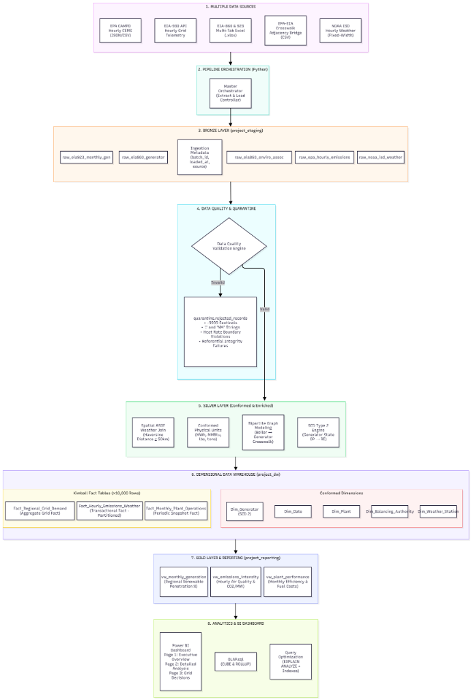
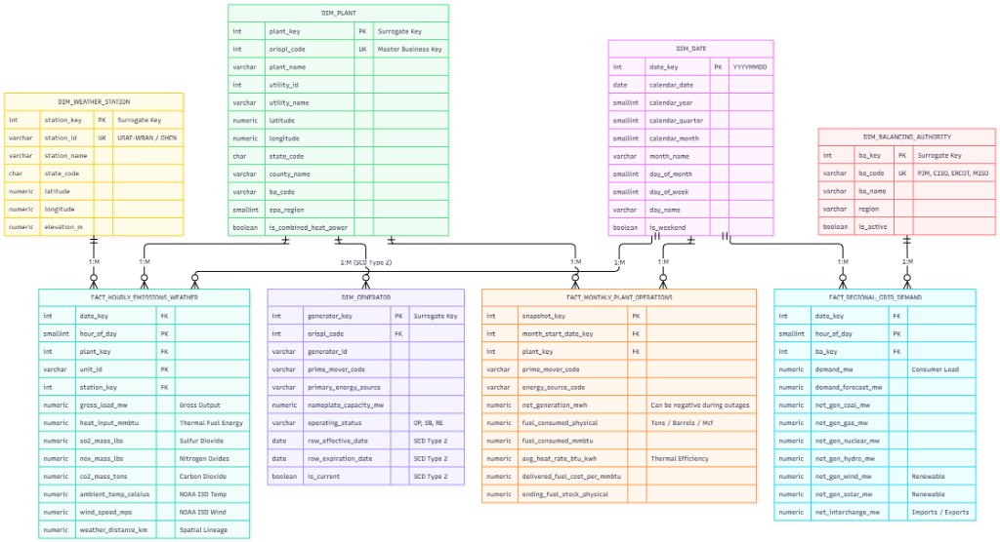

# Integrated Analysis of U.S. Bulk Power Generation, Smokestack Air Emissions, and Synoptic Weather: A Dimensional Data Warehouse and Business Intelligence Solution

**Phase 1 Project Proposal and Design Document**

Muhammad Ibrahim (24L-2602), Rai Fahad Sultan (24L-2509), Muhammad Ayyan (24L-2568), and Taha Imran (24L-2560)

FAST National University of Computer and Emerging Sciences

DL3004: Data Warehousing and Business Intelligence (DWBI)

Instructor: [Instructor Name]

[Submission Date]

---

## Abstract

Electricity generation, the air pollution it produces, and the weather that shapes it are published by three different U.S. agencies in different formats, at different time grains, and with different data quality conventions. This project designs a dimensional data warehouse that integrates six public sources: EIA-860 generator inventory, EIA-923 monthly generation and fuel, EIA-930 hourly grid telemetry, EPA CAMPD hourly smokestack emissions, the EPA-EIA boiler-to-generator crosswalk, and NOAA ISD hourly weather. The design uses a Bronze, Silver, and Gold layered pipeline built on PostgreSQL and Python, a Kimball star schema with five conformed dimensions and three fact tables at three grains, a Type 2 slowly changing dimension for generator status, and a quarantine mechanism for rows that break data contracts. A Power BI dashboard will present the results to management. This document covers the business requirements, source analysis, architecture, dimensional model, data quality strategy, analytics plan, and project plan that Phases 2 and 3 will implement.

*Keywords:* data warehouse, dimensional modeling, ETL, medallion architecture, power generation, emissions, Power BI

---

## Table of Contents

1. Introduction
2. Business Requirements and Analytical Questions
3. Data Source Analysis
4. Proposed Architecture
5. Dimensional Model Design
6. ETL, Data Quality, and Governance Strategy
7. Analytics and Business Intelligence Plan
8. Project Plan, Risks, and Deliverables

References, Appendix A (Source Selection), Appendix B (Glossary)

---

## 1. Introduction

### 1.1 Background

Electric power generation is a major source of carbon dioxide, sulfur dioxide, and nitrogen oxide emissions in the United States. How much a plant emits depends on the fuel it burns, how efficiently it converts heat to electricity, how hard the grid is asking it to work, and the weather on that day. Each of these factors is measured by a different organization. The U.S. Energy Information Administration (EIA) publishes plant inventories, monthly generation, and hourly grid demand (EIA, n.d.-a, n.d.-b, n.d.-c). The U.S. Environmental Protection Agency (EPA) publishes hourly smokestack measurements and the crosswalk that links boilers to generators (EPA, n.d.-a, n.d.-b). The National Oceanic and Atmospheric Administration (NOAA) publishes hourly surface weather (National Centers for Environmental Information [NCEI], n.d.).

### 1.2 Problem Statement

An analyst who wants to know why a plant's emissions rose during a heat wave must combine files that do not match each other. The sources use Excel workbooks with shifting header rows, JSON and CSV feeds, and fixed-width text. They report at different grains: per stack unit per hour, per plant per month, and per balancing authority per hour. They mark missing data with text such as `.` and `NM` and with the integer `-9999`. Without a designed warehouse, every analysis repeats this cleanup, and results from different analysts cannot be compared.

### 1.3 Project Objectives

1. Design a dimensional warehouse that integrates the six sources into one consistent, documented model.
2. Define a layered pipeline (Bronze, Silver, Gold) with orchestration, data quality validation, and quarantine of rejected rows.
3. Model slowly changing history for generator operating status using SCD Type 2.
4. Specify surrogate-key loading, reconciliation checks, and audit logging so that the warehouse is trustworthy and traceable.
5. Plan the analytical SQL, OLAP queries, reporting views, query tuning, and Power BI dashboard that turn the warehouse into a decision-support system.

### 1.4 Scope

**In scope:** the six sources listed in Chapter 3; a PostgreSQL warehouse with schemas `project_staging`, `quarantine`, `project_dw`, and `project_reporting`; Python ETL; analytical SQL; and a three-page Power BI dashboard.

**Out of scope:** FERC Form 1 financial data (considered during research, not modeled), real-time streaming, and predictive modeling. All data is public, so no personal or confidential data is processed.

### 1.5 Team and Collaboration Model

| Member | Student ID |
| :--- | :--- |
| Muhammad Ibrahim | 24L-2602 |
| Rai Fahad Sultan | 24L-2509 |
| Muhammad Ayyan | 24L-2568 |
| Taha Imran | 24L-2560 |

The team works as a cross-functional group. Every member takes part in data engineering, dimensional modeling, data quality, OLAP, and reporting, without fixed role boundaries. Work is shared through a GitHub repository with branches and reviewed pull requests (see the Project Execution Plan).

### 1.6 Organization of This Document

Chapter 2 states what the business needs to know. Chapter 3 analyzes the data sources. Chapter 4 presents the architecture. Chapter 5 presents the dimensional model. Chapter 6 covers ETL and data quality. Chapter 7 plans analytics and the dashboard. Chapter 8 gives the project plan and deliverables.

---

## 2. Business Requirements and Analytical Questions

### 2.1 Scenario and Stakeholders

The scenario is an energy analytics group that supports three audiences:

- **Grid and operations planners**, who need to know when demand peaks and how the fuel mix responds.
- **Environmental and compliance analysts**, who need emission volumes and intensity by plant and region.
- **Executive management**, who need a few reliable indicators and a clear recommendation.

### 2.2 Analytical Questions

| ID | Business question | Fact table(s) | Reporting view / Query | Dashboard page |
| :-: | :--- | :--- | :--- | :-: |
| BQ1 | Which plants and states emit the most CO2, SO2, and NOx per unit of generation, and how does this change month to month? | Hourly emissions | `vw_emissions_intensity` & OLAP Query 4 | 1, 2 |
| BQ2 | How do ambient temperature and wind relate to plant load and emission intensity? | Hourly emissions | `vw_emissions_intensity` & OLAP Query 6 | 2 |
| BQ3 | Which prime mover and fuel combinations run least efficiently (highest heat rate), and how do delivered fuel costs vary? | Monthly operations | `vw_plant_performance` & OLAP Query 1 | 2 |
| BQ4 | Which plants report negative net generation because station service exceeds output, and how often? | Monthly operations | `vw_plant_performance` & OLAP Query 7 | 2 |
| BQ5 | Which balancing authorities have the highest demand peaks and renewable penetration, and how does the fuel mix change over time? | Grid demand | `vw_grid_stress` & OLAP Query 2 | 1, 3 |
| BQ6 | Do EPA gross generation and EIA net generation reconcile for each plant? | Hourly emissions, monthly operations | Audit checks & OLAP Query 8 | 2 |
| BQ7 | How do generator operating status and capacity change over time (for example, Operating to Retired)? | `dim_generator` (SCD Type 2) | Generator history & OLAP Query 9 | 2 |
| BQ8 | How do extreme climatic events (deep winter freezes and summer heat waves) trigger grid demand forecast errors, thermal peaking ramp-ups, and regional reserve deficits? | Grid demand, hourly emissions | `vw_grid_stress` & OLAP Query 10 | 3 |
| BQ9 | During the top 5% peak demand hours within each balancing authority, what proportion of generation is supplied by rapid-start thermal peakers versus baseload and renewables? | Grid demand | `vw_grid_stress` & OLAP Query 11 | 3 |
| BQ10 | How has the monthly generation mix, total net generation volume, and weighted heat rate transitioned across prime mover technologies over the 2021-2024 compliance period? | Monthly operations | `vw_monthly_generation_mix` & OLAP Query 3 | 2 |

### 2.3 Success Criteria

- Every question above can be answered from the warehouse with SQL, without touching raw files.
- Every fact row resolves to a dimension row (zero orphan keys).
- Data quality results, rejected-row counts, and reconciliation differences are reported for each load.
- The dashboard ends with a stated management decision supported by the figures shown.

---

## 3. Data Source Analysis

### 3.1 Source Inventory

| Source | Agency | Content | Format | Native grain |
| :--- | :--- | :--- | :--- | :--- |
| EIA-860 | EIA | Plant and generator inventory; boiler-to-generator associations (`6_1_EnviroAssoc`) | Multi-tab Excel | Annual, per generator or boiler |
| EIA-923 | EIA | Net generation, fuel consumed, heat content, delivered fuel cost, fuel stocks | Multi-tab Excel | Monthly, per plant, prime mover, and fuel |
| EIA-930 | EIA | Hourly demand, day-ahead forecast, generation by fuel, interchange | REST JSON API or CSV | Hourly, per balancing authority |
| EPA CAMPD | EPA | Gross load, heat input, SO2, NOx, and CO2 from continuous emission monitors | REST JSON API or bulk CSV | Hourly, per stack or boiler unit |
| EPA-EIA crosswalk | EPA and EIA | Identifier mapping between plants, boilers, and generators | CSV or Excel | Boiler-to-generator links |
| NOAA ISD | NOAA | Temperature, wind speed, dew point, pressure | Fixed-width or CSV | Hourly, per weather station |

### 3.2 Why This Combination

An earlier research phase evaluated 18 open-data candidates against production data engineering criteria, including mixed formats, slowly changing dimensions, incremental loading, and late corrections (Appendix A). EPA CAMPD scored among the strongest candidates. The team extended it with EIA and NOAA data because the combination exercises every design problem the course covers on one coherent subject: three grains (hourly stack, monthly plant, hourly grid), three formats, a many-to-many link between boilers and generators, a natural Type 2 dimension in generator status, and a cross-source accuracy test (EPA gross generation against EIA net generation). It also gives a business story that is easy to explain.

### 3.3 Known Data Challenges

Profiling of the source files identified the following issues, and the design handles each one.

| Challenge | Evidence | Design response |
| :--- | :--- | :--- |
| Header rows move between files | EIA-860 `6_1_EnviroAssoc` has headers on row 2; EIA-923 has headers on row 6 | Extractors search for the header row (for example the cell containing `Plant Code` or `Plant Id`) instead of using a fixed row number |
| Text sentinels in numeric columns | EIA-923 uses `.` and `NM`; NOAA uses `-9999` and appends quality flags to numbers | Convert sentinels to `NULL`; split quality flags into their own column; quarantine rows that fail a rule |
| Negative net generation | In the profiled January 2023 EIA-923 data, 41 plants reported negative net generation, because an offline plant draws station power from the grid | Allow negative values in `net_generation_mwh`; keep and flag these rows rather than reject them |
| Different plant populations | EIA-860 `EnviroAssoc` covers 1,568 thermal plants; EIA-923 covers 12,308 plants; 10,955 plants in EIA-923 have no boiler record (hydro, solar, wind) | Never inner join generation to boiler data; use the unknown member for non-thermal plants |
| Many-to-many boilers and generators | One plant can have several boilers feeding several generators | Model the crosswalk as a bipartite graph in Silver to avoid a Cartesian product |
| Different time grains | Hourly grid data cannot be pushed down to individual plants | Keep three fact tables at three grains, linked by conformed dimensions |
| No weather at plants | Plants do not have their own weather stations | Nearest-station join within 50 km and ±60 minutes, with the match distance stored |

### 3.4 Volume Plan

The course minimums are at least 100 dimension records and 10,000 fact records. The hourly emissions and grid facts will be far larger than 10,000 rows even for a short date range. `dim_date` (one row per day), `dim_plant` (the project profile covers 254 plants with multi-boiler topology), and `dim_generator` will each exceed 100 rows. `dim_balancing_authority` and `dim_weather_station` depend on the extract chosen in Phase 2, and the extract will be sized to meet the minimum. The Phase 2 extract is bounded by state and date range so that it loads on a local machine.

---

## 4. Proposed Architecture



*Figure 1. End-to-end pipeline architecture.*

### 4.1 Pipeline Stages

The pipeline follows the course flow of source systems, ingestion, staging, cleaning and transformation, warehouse, OLAP, and BI reporting, using a medallion layout.

| Stage | Component | Role |
| :-: | :--- | :--- |
| 1 | Data sources | Six public sources in four formats |
| 2 | Orchestration | A Python controller runs: ingest, validate, transform, load dimensions, load facts, build marts, test and reconcile, log run |
| 3 | Bronze (`project_staging`) | Raw, text-typed copies of every source with `batch_id` and `ingested_at` |
| 4 | Data quality and quarantine | Rules separate valid rows from rejected rows, which are stored with a reason in `quarantine.rejected_records` |
| 5 | Silver | Conformed units, deduplication, crosswalk graph, spatial weather join, SCD Type 2 detection, watermark-based incremental logic |
| 6 | Warehouse (`project_dw`) | Five conformed dimensions and three fact tables |
| 7 | Gold (`project_reporting`) | Three reporting views for Power BI |
| 8 | Analytics and BI | OLAP queries, window functions, indexing, and the dashboard |

The full specification, including the mapping to the course's 11-component reference architecture and the DDL, is in `Phase_1_Architecture_and_Schema_Specification.md`.

### 4.2 Technology Stack

PostgreSQL 16 or later (schemas `project_staging`, `quarantine`, `project_dw`, `project_reporting`), Python 3.10 or later (`pandas`, `openpyxl`, `requests`, `psycopg2`), Microsoft Power BI Desktop, Draw.io, and GitHub. The stack is free and local, and all logic is kept in reproducible SQL and Python scripts, as the course requires.

---

## 5. Dimensional Model Design



*Figure 2. Dimensional model with five dimensions and three fact tables.*

The model follows Kimball's four design steps: choose the business process, declare the grain, identify the dimensions, and identify the facts (Kimball & Ross, 2013).

### 5.1 Business Processes and Grain

| Business process | Fact table | Type | Grain (one row per...) |
| :--- | :--- | :--- | :--- |
| Hourly smokestack emissions and weather | `fact_hourly_emissions_weather` | Transactional, partitioned | Generating unit at a plant, per hour |
| Monthly plant operations | `fact_monthly_plant_operations` | Periodic snapshot | Plant, prime mover, and energy source, per month |
| Hourly grid demand and dispatch | `fact_regional_grid_demand` | Aggregate grid | Balancing authority, per hour |

### 5.2 Dimensions

| Dimension | Surrogate key | Business key | SCD type | Description |
| :--- | :--- | :--- | :-: | :--- |
| `dim_date` | `date_key` (`YYYYMMDD`) | `calendar_date` | Static | Calendar attributes: year, quarter, month, day name, weekend flag |
| `dim_plant` | `plant_key` | `orispl_code` | 1 | Facility name, utility, location, county, state, balancing authority code, EPA region, combined heat and power flag |
| `dim_generator` | `generator_key` | `orispl_code` + `generator_id` | **2** | Prime mover, energy source, nameplate capacity, operating status, effective and expiration dates, current flag |
| `dim_balancing_authority` | `ba_key` | `ba_code` | 1 | Grid operator code, name, region, active flag |
| `dim_weather_station` | `station_key` | `station_id` | 1 | Station name, state, coordinates, elevation |

### 5.3 Facts

| Fact table | Measures |
| :--- | :--- |
| `fact_hourly_emissions_weather` | Gross load (MW), heat input (MMBtu), SO2 (lbs), NOx (lbs), CO2 (short tons), ambient temperature (°C), wind speed (m/s), distance to weather station (km) |
| `fact_monthly_plant_operations` | Net generation (MWh, may be negative), fuel consumed (physical units and MMBtu), average heat rate (Btu/kWh), delivered fuel cost ($/MMBtu), ending fuel stock |
| `fact_regional_grid_demand` | Demand (MW), demand forecast (MW), net generation by coal, gas, nuclear, hydro, wind, and solar (MW), net interchange (MW) |

Additivity rules are documented in the specification. For example, heat rate and fuel cost are ratios and are recomputed from sums, and temperature is averaged.

### 5.4 Key Design Decisions

1. **Three facts at three grains.** Each source keeps its native grain. The conformed date dimension and the balancing authority code on `dim_plant` connect them for drill-across analysis.
2. **`dim_generator` as a Type 2 outrigger of `dim_plant`.** Generator status changes over time (for example, Operating to Retired), and history must be preserved. Facts are not forced down to generator grain, because the source data does not support it.
3. **Surrogate keys everywhere, with an unknown member.** Facts store surrogate keys only. Each dimension has a `-1` unknown member so unmatched keys do not drop rows.
4. **Partitioning.** The hourly emissions fact is range-partitioned on `date_key`.
5. **Negative net generation is kept and flagged.** It is a valid physical result, not an error.

---

## 6. ETL, Data Quality, and Governance Strategy

### 6.1 Staging Transformations

Staging and Silver apply the four transformations required for Phase 2.

| Transformation | Rule | Example |
| :--- | :--- | :--- |
| Remove duplicates | Keep one row per business key (and timestamp for hourly data), preferring the most recent batch | Two identical CEMS rows for the same unit and hour become one |
| Handle `NULL` values | Convert sentinels (`.`, `NM`, `*`, empty string, `-9999`) to `NULL`; quarantine rows missing a required key | `NM` in a numeric field becomes `NULL` |
| Standardize text | Trim, normalize case, and uppercase two-letter state codes | `" mobile "` and `"MOBILE"` both become `Mobile` |
| Convert data types | Cast text to `NUMERIC`, `DATE`, and `SMALLINT`; split date and hour; conform units | `"3555.565"` becomes `3555.565`; hour `"07"` becomes `7` |

### 6.2 Surrogate Key Loading

Dimensions are loaded first. Facts are then loaded by looking up each business key in its dimension and storing the surrogate key.

```text
EPA record: oris_code = 3, date = 2023-01-15, hour = 7
    -> dim_plant.orispl_code = 3        ->  plant_key = 101
    -> dim_date.calendar_date           ->  date_key = 20230115
    -> fact_hourly_emissions_weather(date_key = 20230115, hour_of_day = 7, plant_key = 101, ...)
```

Rows with no matching dimension row are sent to quarantine, not loaded with a broken key.

### 6.3 Data Quality Framework

| Category | Check | Target |
| :--- | :--- | :--- |
| Completeness | Missing values in required columns | Reported per table; required keys must be 0 null |
| Accuracy | Totals reconcile between layers and sources; heat rate inside technology bounds | Silver totals equal fact totals; reconciliation differences reported |
| Integrity | Foreign key validation | Fact rows without a matching dimension row = 0 |

Business rules include technology-specific heat rate limits (combined cycle 5,000 to 14,000 Btu/kWh, coal steam 8,500 to 18,000, simple-cycle gas turbine 9,000 to 22,000) and a conservation rule that net generation (EIA-923) must not exceed gross generation (EPA CAMPD) by more than 2% without a combined heat and power credit. Formulas are in the specification.

### 6.4 Quarantine, Audit, and Lineage

- **Quarantine.** `quarantine.rejected_records` stores the full raw row as JSON with the reason, source table, batch ID, and timestamp, so a rejected row can be investigated and replayed.
- **Audit.** `project_staging.etl_run_log` records rows read, inserted, updated, and rejected for each pipeline step, with status and error text.
- **Lineage.** Every Bronze row carries `batch_id` and `ingested_at`. The data dictionary documents the path from each source field to its warehouse column and to the Power BI visual that uses it.
- **Incremental loading.** Bronze is append-only by batch. Silver keeps a watermark of the last loaded date per source. Fact loads insert only keys not yet present, so a re-run does not duplicate data.

---

## 7. Analytics and Business Intelligence Plan

### 7.1 Analytical SQL and OLAP

| Technique | Planned query | Business question |
| :--- | :--- | :--- |
| Aggregation (`SUM`, `AVG`, `COUNT`) | Monthly net generation and emissions by plant | BQ1, BQ3 |
| Window function (`LAG`) | Month-over-month change and growth percent in net generation | BQ1, BQ4 |
| `ROLLUP` | Grid demand by year, quarter, month, and balancing authority, with subtotals and a grand total | BQ5 |
| `CUBE` | Net generation and heat rate across year, state, and fuel | BQ3 |

### 7.2 Reporting Views

| View | Purpose |
| :--- | :--- |
| `vw_emissions_intensity` | Daily/hourly plant emissions, carbon intensity, and ambient temperature (Feeds Page 1, 2) |
| `vw_plant_performance` | Monthly net generation, fuel use, heat rate, fuel cost, and outage indicator (Feeds Page 2) |
| `vw_grid_stress` | Hourly balancing-authority demand, generation mix, renewable penetration, and stress alerts (Feeds Page 3) |
| `vw_monthly_generation_mix` | Monthly prime mover and fuel generation mix, weighted heat rate, and decarbonization trends (Feeds Page 2 & BQ10) |


### 7.3 Query Optimization

For the heaviest queries the team will record `EXPLAIN ANALYZE` output, create B-tree indexes on foreign keys and date columns, record `EXPLAIN ANALYZE` again, and compare execution time and query cost. The partitioned hourly fact will also be compared with an unpartitioned copy to show partition pruning.

### 7.4 Power BI Dashboard

| Page | Content |
| :--- | :--- |
| 1. Executive Overview | KPI cards for total net generation, total CO2, average carbon intensity, and renewable penetration; monthly generation trend |
| 2. Detailed Analysis | Plant and emissions analysis, regional analysis by state and balancing authority, segmentation by prime mover and fuel (heat rate matrix), and temperature versus carbon intensity |
| 3. Decision Page | The question "Based on the dashboard, what decision should management take?", answered with a recommendation and the figures that support it |

The dashboard connects directly to the `project_reporting` views in PostgreSQL.

---

## 8. Project Plan, Risks, and Deliverables

### 8.1 Timeline and Weighting

| Phase | Weeks | Focus | Weight |
| :--- | :-: | :--- | :-: |
| 1 | 1 to 3 | Design | 30% |
| 2 | 4 to 6 | Physical warehouse and ETL | 40% |
| 3 | 7 to 8 | OLAP, optimization, and Power BI | 30% |

The project carries 15% of the course grade. The week-by-week plan, Git workflow, and task breakdown are in `Phase_1_Project_Execution_Plan.md`.

### 8.2 How This Design Meets Later Phases

| Later requirement | Where the design prepares for it |
| :--- | :--- |
| Phase 2: schemas `project_staging`, `project_dw`, `project_reporting` | Chapter 4 and the DDL |
| Phase 2: 100+ dimension rows and 10,000+ fact rows | Section 3.4 |
| Phase 2: deduplicate, handle nulls, standardize text, convert types | Section 6.1 |
| Phase 2: surrogate keys and business-key lookup | Section 6.2 and the key map in the data dictionary |
| Phase 2: completeness, accuracy, and integrity checks | Section 6.3 |
| Phase 3: `SUM`, `AVG`, `COUNT`, growth, `ROLLUP`, `CUBE` | Section 7.1 |
| Phase 3: `vw_` reporting views | Section 7.2 |
| Phase 3: `EXPLAIN ANALYZE` before and after indexes | Section 7.3 |
| Phase 3: three-page dashboard with a decision page | Section 7.4 |

### 8.3 Principal Risks

| Risk | Mitigation |
| :--- | :--- |
| Source files change layout between years | Dynamic header discovery; profiling before each load |
| Hourly files are too large for local hardware | Bounded extract by state and date range; batch loads |
| API limits or downtime | Cache raw files in `02_Data/raw_data`; idempotent loads |
| Weather match is too distant to be meaningful | 50 km limit and a stored distance column |
| Crosswalk produces duplicate rows | Bipartite modeling and row-count checks after each join |
| Merge conflicts across four contributors | Feature branches and reviewed pull requests |

### 8.4 Phase 1 Deliverables

| Deliverable | File |
| :--- | :--- |
| Project proposal and design document | `Phase_1_Project_Proposal_and_Design_Document.md` (this document) |
| Architecture and schema specification | `Phase_1_Architecture_and_Schema_Specification.md` |
| Data dictionary | `Phase_1_Data_Dictionary.md` and `Data_Dictionary.xlsx` |
| Architecture diagram | `Architecture_Pipeline_Diagram.png` |
| Star schema diagram | `Schema_Diagram.jpg` |
| Execution plan | `Phase_1_Project_Execution_Plan.md` |
| Executive summary and checklist | `Phase_1_Executive_Summary_and_Checklist.md` |

---

## References

Kimball, R., & Ross, M. (2013). *The data warehouse toolkit: The definitive guide to dimensional modeling* (3rd ed.). John Wiley & Sons.

National Centers for Environmental Information. (n.d.). *Integrated Surface Database (ISD)* [Data set]. National Oceanic and Atmospheric Administration. https://www.ncei.noaa.gov/products/land-based-station/integrated-surface-database

U.S. Energy Information Administration. (n.d.-a). *Annual Electric Generator Report (Form EIA-860)* [Data set]. https://www.eia.gov/electricity/data/eia860/

U.S. Energy Information Administration. (n.d.-b). *Power Plant Operations Report (Form EIA-923)* [Data set]. https://www.eia.gov/electricity/data/eia923/

U.S. Energy Information Administration. (n.d.-c). *Hourly Electric Grid Monitor (Form EIA-930)* [Data set]. https://www.eia.gov/electricity/gridmonitor/dashboard/electric_overview/US48/US48

U.S. Environmental Protection Agency. (n.d.-a). *Clean Air Markets Program Data (CAMPD)* [Data set]. https://campd.epa.gov/

U.S. Environmental Protection Agency. (n.d.-b). *Power sector data crosswalk* [Data set]. https://www.epa.gov/power-sector/power-sector-data-crosswalk

---

## Appendix A: Source Selection

Before choosing this subject, the team evaluated 18 open-data candidates (including USAspending.gov, the Australian AEMO electricity market data, OpenAlex, EPA CAMPD, Overture Maps, OpenFEMA, and NOAA Storm Events). Each was scored from 1 to 5 on several criteria, with uniqueness and incremental-load feasibility weighted double, for a maximum of 40. In that single-source ranking EPA CAMPD scored 36 of 40, fourth overall. The full evaluation is preserved in `01_Project_Documentation/research/candidate_datasets_evaluation_18.md` as supporting evidence. The final design extends EPA CAMPD with EIA and NOAA sources to add multiple grains, a many-to-many link, and a cross-source reconciliation (Section 3.2).

## Appendix B: Glossary

| Term | Meaning |
| :--- | :--- |
| BA | Balancing authority: the operator that balances electricity supply and demand in a region |
| CAMPD | Clean Air Markets Program Data (EPA) |
| CEMS | Continuous emission monitoring system |
| CHP | Combined heat and power (cogeneration) |
| DQ | Data quality |
| EIA | U.S. Energy Information Administration |
| EPA | U.S. Environmental Protection Agency |
| ETL | Extract, transform, load |
| Heat rate | Fuel energy needed per unit of electricity produced (Btu/kWh); lower is more efficient |
| ISD | Integrated Surface Database (NOAA) |
| MMBtu | Million British thermal units |
| NOAA | National Oceanic and Atmospheric Administration |
| ORISPL | Office of Regulatory Information Systems plant code; the plant business key |
| SCD | Slowly changing dimension |
