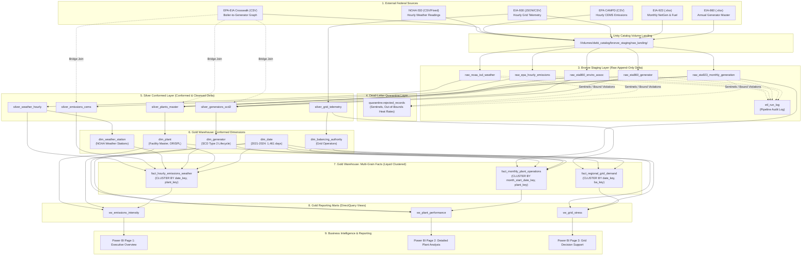

# End-to-End System Dependency Map & Data Lineage Architecture

**Document Status:** Complete & Verified Baseline  
**Verification Date:** November 8, 2026  
**Audience:** Data Engineers, Pipeline Orchestrators, Reliability Engineers  
**System Scope:** Federal Ingestion $\longrightarrow$ Lakehouse Medallion Tiers $\longrightarrow$ Power BI DirectQuery  

---

## 1. End-to-End Architectural Data Lineage Flow

The pipeline operates across five architectural tiers within Unity Catalog (`dwbi_catalog`):



---

## 2. File & Component Dependency Hierarchy

The project codebase follows a strict hierarchical dependency tree anchored by `03_ETL/config.py`:

```
03_ETL/config.py (Master Configuration & Infrastructure Initializer)
│
├── Consumed by: DATABRICKS_SERVERLESS_ARCHITECTURE.md (Architecture specification)
├── Consumed by: PROJECT_BLUEPRINT.md (System Blueprint & SQL DDL)
├── Consumed by: archived/early_sql_drafts/staging.sql (Matches CATALOG_CONFIG["SCHEMAS"])
├── Consumed by: archived/early_sql_drafts/warehouse.sql (Matches DIMENSION_ATTRIBUTES)
├── Consumed by: archived/early_sql_drafts/quality_checks.sql (Matches DATA_QUALITY_RULES)
├── Consumed by: archived/early_sql_drafts/Views.sql (Matches schema dwbi_catalog.gold_marts)
│
└── Planned Pipeline Execution Sequence:
    ├── Step 1: 03_ETL/config.py (Initializes Catalog, Schemas, Volume, Audit Tables)
    ├── Step 2: 01_bronze_ingestion.py (Extracts from Volume to Bronze Delta Tables)
    ├── Step 3: 02_silver_cleansing_and_scd.py (Cleanses, Applies Sentinels, Quarantines, SCD2)
    ├── Step 4: 03_gold_star_schema_facts.py (Populates Dims & Facts with Liquid Clustering)
    ├── Step 5: 04_gold_reporting_marts.py (Creates Reporting Views for Power BI)
    └── Step 6: 06_Dashboard/PowerBI.pbix (Connects via DirectQuery to gold_marts)
```

---

## 3. Pipeline Execution Sequence & Critical Path Prerequisites

To ensure data integrity, pipeline execution must adhere to strict sequential prerequisites:

| Step # | Pipeline Stage | Input Dependency | Output Target | Prerequisite Condition |
| :---: | :--- | :--- | :--- | :--- |
| **0** | **Catalog Setup** | Databricks Workspace | `dwbi_catalog` Schemas & Volume | Active Unity Catalog metastore; user has `CREATE CATALOG` privilege. |
| **1** | **Raw Landing** | Federal Source URLs | `/Volumes/.../raw_landing` | Bulk files downloaded/placed in Volume without manual filename renaming. |
| **2** | **Bronze Ingestion** | Raw Volume files | `bronze_staging.raw_*` | Programmatic dynamic header discovery (`'Plant Code'`, `'Plant Id'`) on Excel files. |
| **3** | **Quarantine Filter**| `bronze_staging.raw_*` | `quarantine.rejected_records` | Sentinel detection rules (`"."`, `"NM"`, `-9999`) and physical heat rate bounds evaluated. |
| **4** | **Silver Conformance**| Cleaned Bronze rows | `silver_conformed.*` | Crosswalk graph linked; spatial Haversine distance $\le 50\text{ km}$; timestamps conformed to UTC/Local. |
| **5** | **SCD Type 2 Merge** | `silver_generators` | `gold_warehouse.dim_generator` | Atomic Delta `MERGE INTO` executed; previous record `valid_to` updated, new record inserted with `is_current = TRUE`. |
| **6** | **Conformed Dims** | `silver_*` tables | `gold_warehouse.dim_*` | Dimension surrogate keys generated; natural keys deduplicated; `dim_date` populated for 2021–2024. |
| **7** | **Fact Loading** | Silver facts + Dims | `gold_warehouse.fact_*` | Surrogate key lookups complete; liquid clustering enabled (`CLUSTER BY`). |
| **8** | **Marts & Views** | `gold_warehouse.*` | `gold_marts.vw_*` | DirectQuery analytical views compiled and validated. |
| **9** | **BI Visual Refresh**| `gold_marts.vw_*` | Power BI Desktop Dashboard | DirectQuery pushdown validated against Serverless SQL Warehouse. |

---

## 4. Failure Blast Radius Analysis

The table below outlines the cascading downstream impacts if an individual upstream component or source system encounters an outage, schema drift, or validation failure:

| Failed Component / Source | Root Failure Event | Affected Upstream Table | Immediate Downstream Impact | End-User Visual / Report Blast Radius | Mitigation / Recovery Strategy |
| :--- | :--- | :--- | :--- | :--- | :--- |
| **EIA-860** | Header row shifts from Row 2 to Row 3 in new annual release. | `bronze_staging.raw_eia860_generator` | Schema drift or column nullification. | Breaks `dim_plant`, `dim_generator`, and downstream fact foreign keys. | Dynamic header search implemented in ingestion logic ([`PROJECT_BLUEPRINT.md#L92-L96`](file:///d:/Semester%20Projects/DWBI%20LAB%20Project/PROJECT_BLUEPRINT.md#L92-L96)). |
| **EIA-923** | Missing value sentinels (`"."`, `"NM"`) unhandled. | `bronze_staging.raw_eia923_monthly_generation` | Spark numeric cast fails or injects corrupt values. | Breaks `fact_monthly_plant_operations` and `vw_plant_performance`. | Routed to `quarantine.rejected_records` with reason `NUMERIC_FIELD_CONTAINS_STRING_SENTINEL`. |
| **EPA CAMPD** | CEMS API endpoint rate-limited or API key expired. | `bronze_staging.raw_epa_hourly_emissions` | Ingestion batch halts; missing hourly emissions records. | Breaks `fact_hourly_emissions_weather` and `vw_emissions_intensity` (Page 1 of Power BI). | Fallback to bulk CSV archive downloads from CAMPD portal ([`03_ETL/config.py#L124`](file:///d:/Semester%20Projects/DWBI%20LAB%20Project/03_ETL/config.py#L124)). |
| **NOAA ISD** | Station dropout or missing measurement (-9999). | `bronze_staging.raw_noaa_isd_weather` | Erroneous temperature readings (-9999°C) corrupt weather averages. | Corrupts ambient temperature correlations in `vw_emissions_intensity`. | Coerced to SQL `NULL` and flagged in quarantine table ([`03_ETL/config.py#L154`](file:///d:/Semester%20Projects/DWBI%20LAB%20Project/03_ETL/config.py#L154)). |
| **EPA-EIA Crosswalk** | Missing plant crosswalk link for new solar/wind plant. | Bipartite adjacency bridge | Join produces null generator key for non-combustion facilities. | Unhandled inner join drops 10,955 non-thermal generation records. | Defensive Left Outer Join with default surrogate key (`-1 = Not Applicable`) ([`PROJECT_BLUEPRINT.md#L107-L113`](file:///d:/Semester%20Projects/DWBI%20LAB%20Project/PROJECT_BLUEPRINT.md#L107-L113)). |
| **Unity Catalog Metastore** | Metastore permissions revoked or connection down. | `dwbi_catalog` | All schemas become inaccessible; 3-tier resolution fails. | Total pipeline halt; Power BI DirectQuery returns connection error. | Fallback toggle to 2-tier local catalog in `config.py` (`USE_UNITY_CATALOG = False`). |
| **Identity Column Invariant Violation** | Explicit key passed to identity column or `UPDATE SET *` attempts overwrite during Delta `MERGE INTO`. | `gold_warehouse.dim_*` | Spark throws `DELTA_IDENTITY_COLUMNS_EXPLICIT_INSERT_NOT_SUPPORTED` or update analysis error. | SCD Type 2 merge fails completely for `dim_generator`. | Target `MERGE` update clause must use `UPDATE SET * EXCEPT (generator_key)` and insert clause must omit explicit values for `GENERATED ALWAYS` columns ([`COMPATIBILITY_BASELINE.md`](file:///d:/Semester%20Projects/DWBI%20LAB%20Project/technical-knowledge/COMPATIBILITY_BASELINE.md)). |

